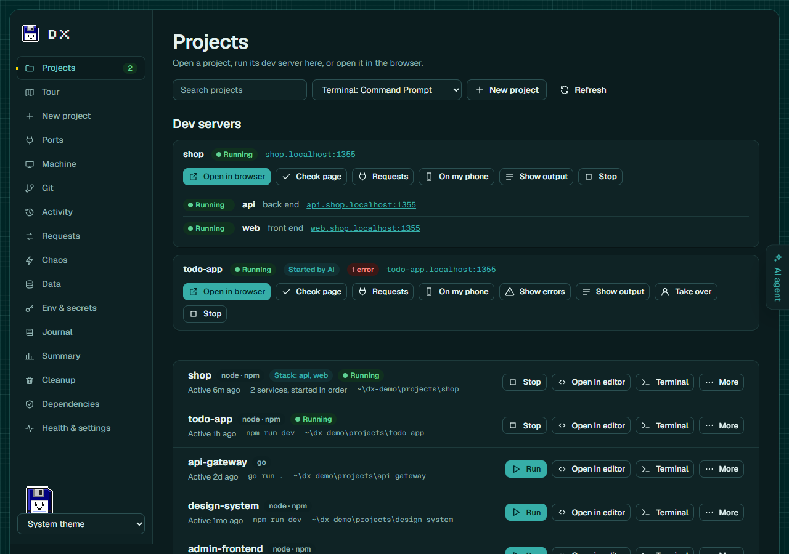
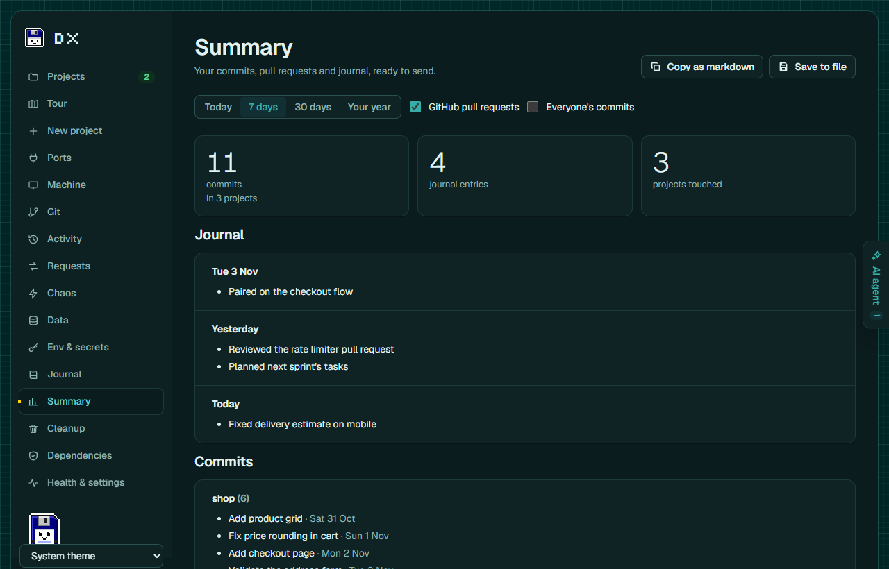
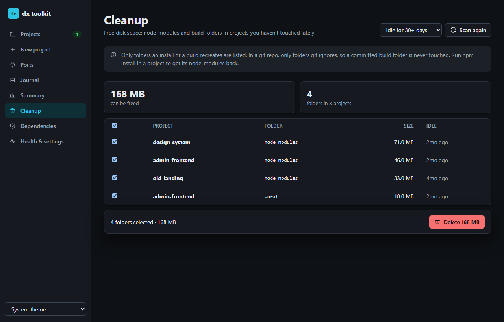

# dx toolkit

Your projects, dev servers, ports, work journal and weekly summary in one place: a local dashboard, a `dx` command, and tools your AI assistant can call. Runs on Windows, macOS and Linux.

**Your AI coding agent can run your app and see what it does.** Claude Code, Cursor and the others start the dev server through dx, read its output, see compile errors and stack traces with their file and line, request pages, and check that a fix worked, while you watch the same server in the dashboard. dx connects itself to the AI tools on your computer: there's nothing to configure.

<picture>
  <source media="(prefers-color-scheme: light)" srcset="docs/images/projects-light.png">
  
</picture>

Each tool is written once in `packages/core` and can be used four ways:

```
packages/core   the tools (projects, ports, journal, …), plain Node, no dependencies
   ├── packages/web      → the dashboard in your browser: `dx ui`
   ├── packages/cli      → `dx` in any terminal, VS Code included
   ├── packages/raycast  → Raycast commands with hotkeys
   └── packages/mcp      → Claude (Desktop / Code) and Raycast AI can call the tools
```

Everything dx stores is in one folder: `~/.dx` (`C:\Users\<you>\.dx`).

| File | What it is |
|---|---|
| `config.json` | Settings: where your projects are, which editor and terminal to open |
| `journal.md` | Your work journal, plain markdown, edit it by hand any time |
| `runs.jsonl` | One line per tool run, so a failure is never silent (`dx runs`) |
| `summaries/` | Saved work summaries, one markdown file per day you ran `dx summary --save` |
| `templates/` | Your project templates for `dx new`, one folder each |
| `activity/` | The activity history: one folder per project, one file per day, kept 7 days |
| `dashboard.json` | While the dashboard runs: its address and access token, readable by you only, so the `dx` command and AI tools can reach it |

---

## Setup

dx runs on **Windows, macOS and Linux**. You need **Node 22 or newer** (`node -v`) and git. Then, in a terminal (PowerShell on Windows):

```bash
npm install -g dx-devkit
```

```bash
dx ui
```

That's all. The first time you use dx it sets itself up:
- **Your projects**: it looks in the usual code folders (`~/projects`, `~/code`, `~/dev`, `~/src`, `~/repos`, `~/Documents/GitHub`, `~/Desktop/projects` and similar) and uses the ones you have.
- **Your editor**: the first of VS Code, Cursor, Windsurf, Zed, Sublime Text or JetBrains it finds.
- **Your AI tools**: it adds itself to Claude Code, Claude Desktop, Cursor, Windsurf and VS Code, whichever are installed, and says so. A tool you install later is connected the next time the dashboard starts. `dx setup --undo` takes it all back.

Projects somewhere else? `dx config add-root <folder>`, or add the folder on the dashboard's Health page. `dx doctor` checks everything and says how to fix what isn't right; your AI tool can run the fixes for you (ask it to "check dx's setup").

- **macOS and Linux**: if `npm install -g` fails with a permissions error, your global npm folder belongs to root. Use a Node version manager (nvm, fnm, Volta) rather than `sudo`.
- **Linux**: `dx port` and `dx kill` need `lsof` (`sudo apt install lsof` or your distro's equivalent). Copying a summary needs `wl-copy` or `xclip`, and "open in a terminal window" uses `x-terminal-emulator`.
- **macOS**: "open in a terminal window" uses Terminal.app; the first time, macOS asks whether your terminal may control it.

> If you switch Node versions with nvm, install dx again on the new version; dx repoints your AI tools at it the next time the dashboard starts.

**Updating**: `dx update`. It stops the dashboard, removes the old install and anything it left behind, and asks before stopping dx processes that AI tools still run, so npm never stops with EEXIST or EPERM. If `dx` itself won't start, `npx -y dx-devkit@latest update` does the same. **Removing**: `dx setup --undo` (takes dx out of your AI tools), then `npm uninstall -g dx-devkit`; your settings and journal stay in `~/.dx`.

**From source**, to change dx itself: clone this repository, then run `npm install` and `npm run link` in it. `npm run link` builds and makes `dx` run this folder's build (rebuilds go live); `npm run unlink` puts the npm package back. Both clean up whichever install was there before. [CONTRIBUTING.md](CONTRIBUTING.md) has the rest.

---

## The dashboard: `dx ui`

```powershell
dx ui
```

It opens the dx dashboard in your browser, where everything `dx` does is a button:

| Page | What you can do there |
|---|---|
| **Projects** | Search your projects; **Run** a dev server right in the page and watch its output live, open it in the browser when it's ready, **Stop** it; see its **errors** with file and line, and open your editor at that line; **Ask Claude to fix** an error and review the patch Claude Code proposes before anything changes (see [Ask Claude to fix](#ask-claude-to-fix)); **Check page** loads it in a headless browser and lists exceptions, console errors and failed requests; **Requests** shows what the app sent through its `.localhost` address and what came back; see servers your AI agent started; **work that isn't backed up** across all projects; **leave a note** on a project for next time; **check its .env** and look for committed keys; **run its tests** and see each failure with file, line, expected and actual; open a project in your editor, in **a terminal** (pick which one at the top of the page: Windows Terminal, PowerShell, Git Bash, iTerm2, Warp, Ghostty and others, whichever you have) or in File Explorer; run its dev server in a terminal window; save one as a template. **Snapshots** (an older commit running, see [Run any commit](#run-any-commit)) show here too, labelled `shop-website @ abc1234`, with their output and errors and **Remove** |
| **Tour** | A map of a project for someone new to it: what it is and what it's built with, how to run it, its pages with the API calls each makes and the file that answers each, its data, the settings it needs (names only) and where the work happens; **Copy as Markdown**. See [Tour](#tour-a-map-of-a-project) |
| **New project** | Create a project from a template or a copy of another, with git and packages installed; or **clone a repository** and get it ready to run |
| **Activity** | Everything that happened in your apps, here and deployed, laid out like opening a project: your projects and recorded sites on the left (with each environment, event and problem counts, and **Open in dx browser** per site), the chosen one's timeline on the right, one line per event, in four views: **Sessions** (each visit's steps: clicks, routes, requests, errors), **APIs** (each endpoint with its calls, payloads, responses, average and slowest time), **Errors** (grouped, with how often and where) and **Console**. Filter by environment (local, staging, production…), or **By AI**: only your AI agent's page checks, with its other calls through dx in between. **Open dx browser** and **Record a site** at the top; a visit on a site that names its deployment shows it, with **Run this commit** when your project has that commit. Every request, error and console line opens **Visual** (status and timing at a glance, JSON as a colour-coded tree that folds, stacks as frames that open your editor) or **Raw** (the exact text). Search payloads and messages, open an error at its line in your editor, **Ask Claude to fix** an exception, server error or console error, **Copy as bug report** on any error, **Download bug bundle** for a teammate to replay, **Open a bug bundle** (or drop the file on the page) to replay one you were sent at its commit, side by side with the original, **Replay** a visit in a headless browser, and **Mock mode**: answer the project's API from what was recorded, with each endpoint's status, delay and body editable (Fail with 500, Empty list, Slow, Offline). See [Replayable bug reports](#replayable-bug-reports) and [Mock mode](#mock-mode). **Time travel**: drag the slider to a moment, see what happened around it, which commit you were on then, and **Run it as it was then**. See [The activity history](#the-activity-history) and [Record deployed sites](#record-deployed-sites) |
| **Requests** | Burp- and Postman-style tools for the app you run: **Rules** that change a request or its answer on the way (headers, JSON fields, body, status), slow it down or make it fail; **Intercept** to hold a call and edit it by hand; the **Repeater** to edit and resend any request; the project's **API spec** with a map of what was called and what doesn't fit the spec; and a **mock server** that answers from the first call, with data from the spec, cached real answers, or written by Claude Code or Codex. See [The Requests page](#the-requests-page-intercept-repeater-rules-api-spec-and-mock-server) |
| **Data** | Realistic, connected data for the development database from its schema, edge cases included, as scenes you switch between in seconds; the data that's there is saved first. **Queries per request**: which database queries each request ran, with N+1 and slow queries named. See [Realistic data](#realistic-data) and [Queries per request](#queries-per-request) |
| **Chaos** | Break the app on purpose, before your users do: **Chaos mode** breaks its API calls the way real networks and servers do (slow, 500s, dropped, logged out, out of order, rate limited, odd data), seeded so a run can be met again, with a report of what the app did about it (blank pages, uncaught errors, stuck spinners, orders sent twice); **Gremlins** click and type through the app at random and bring back the steps to each crash; a fake **Clock** and time zone for the page; a **Weak phone** on 3G in the dx browser; **Languages** (pseudo text and right to left, and a check for text that's cut off or never translated); **Missing values** (which .env values matter); a **Behaviour diff** against an earlier commit; the **Graveyard** of routes and pages nobody used; and **Security**, a friendly attack on your own app. See [Chaos](#chaos-break-the-app-before-your-users-do) |
| **Env & secrets** | Every project's `.env` files (subfolders included): see them with values hidden until you ask, edit and save them, or open them in your editor. Warnings for `.env` files git would commit or already has, projects with no `.gitignore`, and keys in committed files; what `.gitignore` is missing to keep secrets out of git (OWASP), with a button that adds it |
| **Ports** | See what's listening and stop it (it asks first, naming the process) |
| **Machine** | **Tools**: Node, npm, pnpm, yarn, bun, deno, git, gh, docker, Python, Go, Java and Rust, each with its version, the newest one, and whether yours still gets security fixes ("Node 18 stopped getting security fixes on 30 Apr 2025"); **Update** opens the right command for how it was installed (nvm, fnm, volta, winget, Homebrew, npm…) in a terminal you can see. **Your projects**: what each project asks for (`.nvmrc`, `engines`, `packageManager`, lock files, `.python-version`, `go.mod`, compose files) next to what's installed, with the command that fixes it. **Running in the background**: dev servers, watchers, AI tools and editor helpers with their memory, CPU and ports, marked **left behind** when the terminal that started them is gone, or **open to your network** when they listen beyond this computer; **Stop** one (it asks first). **Docker**: containers, and the space images, stopped containers and the build cache take, with **Clean up** (never volumes). **Services**: databases that start with the computer, with the commands that stop them |
| **Git** | A project's changes as cards: **drag** them from **Changes** to **Staged** (or press the arrow on a card; Ctrl+click and Shift+click pick several), open one to see its changes side by side and **stage one block** at a time, write the message and **Commit**. **Drag a branch** onto the one you're on to merge it (with a preview of the commits and the files that would conflict; Merge, Squash or Fast-forward), or yours onto another to rebase. **Drag a commit** out of the graph onto Revert, Copy onto this branch (cherry-pick), New branch here, Tag here, Edit history from here (reorder, reword, squash, fold or drop, as cards) or Go back here. A **Shelf** to drag changes onto and back off (stash), a bin to discard them, **conflicts** shown side by side with Keep yours, Keep incoming or Keep both per block, then Continue or Abort; branches and tags created, switched, renamed and deleted, and tags pushed (one, or all of them); Fetch, Pull and Push (force only with lease), kept apart from committing: a commit stays on your computer until you press Push or drag your branch onto the remote. Amend the last commit. With Claude Code installed, **Write message** has it write the commit message from what's staged, in the repository's own style, for you to edit (it sends the staged diff to your Claude account, only when you click). **Every step can be undone**, from the Undo button or the Undo history, and git's reflog is there to go back further. The **history as a graph** draws itself in, lights up a branch's path under the mouse, shows each author's initials in the dots and branch pills in their lane's colour; open a commit for its message, its diff (**Visual** side by side, or **Raw**) and the same actions as buttons. **Search commits** by message, hash, author or a file they changed, and **Run this commit** (from a result, a commit's detail, or by dragging it onto Run this commit): the app as it was, next to your own dev server (see [Run any commit](#run-any-commit)). **Visual diffs**: while dx runs the dev server, each commit gets a small screenshot in its row, and an **orange ring** on its dot when it changed how the app looks; open it for **before and after** as a wipe you drag, side by side, or the changed pixels, with "3% of the page changed, around the Checkout button" (see [Visual diff](#visual-diff)), and **Capture now**. **Proof for the pull request** writes how the branch was tested, to copy or add to its pull request (see [Proof for the pull request](#proof-for-the-pull-request)). Changes made in your editor or a terminal show up by themselves |
| **Journal** | Add what you did, read back 7, 30 or 90 days |
| **Summary** | Your week: commits, pull requests, journal, where the time went, uncommitted work; copy it as markdown or save it. **Your year** tells the year as a story, one card each: commits, active days and the longest streak, the busiest week, a heat map of when you code (weekday by hour), the project of each month, your most-touched files, bugs squashed, the biggest day, languages by files changed, time with dev servers running, your first and latest commit, your journal's most-used words and your AI agent's calls through dx. Pick another year; **Copy as markdown** and **Save** keep the same numbers. Made from your own commits on this computer; nothing leaves it |
| **AI lane** (every page) | While an AI agent works through dx (a call in the last 5 minutes, or a server it started still running), a panel slides in at the right edge with a live feed of what it does: "Started shop-website's dev server", "Loaded /checkout on shop-website: 2 errors", "Read shop-website's activity log", each linking to the dev server's card, the Activity page (filtered **By AI**) or the page it touched. **Interrupt** stops every dev server the agent started, after naming them (dx can't stop the agent itself; tell it to stop in your AI tool). **Take over** makes a server the agent started yours. Collapse it to a tab; that's remembered |
| **Cleanup** | See which `node_modules` and build folders can go, pick them, delete them (it asks first) |
| **Dependencies** | Run the audit across all projects (npm, pnpm, yarn and bun) with a progress bar; open a row for its outdated packages, and **Update packages** within their ranges, or **Try it** on one: the upgrade in a throwaway copy, with its type check, build, tests and pages before and after (see [Try an upgrade](#try-an-upgrade)) |
| **Health & settings** | `dx doctor`'s checks with how to fix each problem, which AI tools are connected (with Connect and Disconnect buttons), your projects folders, editor, terminal and GitHub username, whether to keep the activity history and for how long, and what dx ran recently |

| Summary | Cleanup |
|---|---|
|  |  |

- **It runs on your computer only**, at `http://dx.localhost` (or `http://127.0.0.1:4646`). Every action needs a secret the page gets when it loads, so other websites can't use it.
- **It's started for you when needed.** When an AI tool asks dx to run a dev server, dx starts the dashboard in the background; `dx ui` then just opens it. A background dashboard stops itself after 30 minutes with no dev servers running and nobody using it. `dx ui --stop` stops it now.
- **Dev servers you start from the dashboard stop when the dashboard stops**, like a dev server stops when you close its terminal. For one that keeps running, use **More → Run in a terminal window**.
- Light and dark follow your system, or pick one at the bottom of the sidebar. It works on a phone-sized window too.
- **The look**: the app sits like a window on a teal desktop with a faint pixel grid, with Floppy as the logo. Its fonts (Geist, Geist Mono and Silkscreen, all under the SIL Open Font License) ship with dx in `packages/web/public/fonts`, so nothing loads from the internet.
- `dx ui --port 5000` uses another port; `dx ui --no-open` doesn't open the browser; `dx ui --app` opens it as an app, in its own window with no tabs or address bar. From the project folder, `npm run ui` does the same as `dx ui`.

---

## Floppy, on your taskbar

`dx floppy` puts Floppy on your Windows taskbar: the save icon come alive, 48 pixels tall. It shows what dx is doing, and clicking it opens the dashboard as an app (its own window and taskbar icon, no tabs or address bar).

- **Its moods follow dx.** Idle, it blinks and looks around. A project starting: it watches a progress bar fill on its label, with the preparing step in its balloon. A server comes up: it hops once. An error: red eyes, a shake and a balloon naming the file and line, until you click it. An AI agent at work: it watches a sparkle. Thirty minutes with nothing happening, or **Quiet for an hour**: it sleeps (errors still wake it).
- **Hover** for what it's watching; **drag** it along the taskbar (it remembers where); **right-click** for Open dx, Quiet for an hour, Start with Windows, and Quit.
- **It starts with Windows.** The first `dx floppy` adds a shortcut to your own Startup folder (no admin rights), and says so; `dx floppy --no-startup` or the menu removes it.
- **It gets out of the way** while a game, a video or a presentation is full screen.
- **It doesn't keep dx running.** It reads the dashboard's state every two seconds without counting as someone using it, so a background dashboard still stops when idle; a click starts it again.
- `dx floppy --stop` takes it off, `--colour charcoal` or `maroon` changes its colours, `--status` says whether it's running.

Nothing to install: the window is Windows PowerShell and WPF, which every Windows 10 and 11 has. On macOS and Linux, `dx floppy` says it's Windows-only for now.

---

## The activity history

Every app you open at its `.localhost` address (the address `dx up`, `dx go` and the dashboard give you), and every deployed site you use in the [dx browser](#record-deployed-sites), leaves a history of what happened, in order:

- **Requests** with their method, address, status, time, and what was sent and returned;
- **Pages** loaded, and **route changes** without a page load (`/cart → /checkout`);
- **Clicks** on buttons and links, and **forms** submitted. What you type is never recorded;
- **Console output** (`console.log`, `warn`, `error`) with the file and line that wrote it, and **uncaught errors** with their stack;
- the **dev server** starting, getting ready, stopping and crashing, and each **error it printed**.


See it on the **Activity** page, with `dx activity`, or ask your AI agent (`activity_log`). On the Activity page:

- **Sessions**: each visit (one page load in a tab) with everything that followed it: the clicks, the requests they set off, and the errors in the browser and on the server.
- **APIs**: every endpoint your app called (`GET /api/cart/:id`, ids folded together), with how many calls, how many failed, the average and slowest time, and each call's payload and response.
- **Errors**: exceptions, console errors, failed requests and server errors, grouped by message, with how often, when first and last, and where in the code.
- **Console**: your app's console output, newest first, repeats folded into one line with a count.
- **Copy as bug report** on an error copies markdown for an issue or an AI chat: the steps that led there, what went wrong, each request with what was sent and returned, and the stack.
- **Replay** a visit: dx opens the page it started on in a headless browser, clicks what you clicked in the same order, and lists what broke. Run it again after a fix to see the problem gone. Your AI agent can do the same with `replay_visit`. What you typed isn't recorded, so fields stay empty.

Nothing to set up:

- **How it's recorded.** Requests go through the local domains proxy, which logs them. For the browser side, the proxy adds one `<script>` tag to your app's HTML pages, served from your app's own address. Browser dev tools leave it out of stack traces, so `console.log` still shows your file and line. Requests the page makes to `localhost:<port>` or other addresses are recorded by that script.
- **At `localhost:5173` too, in any browser.** When dx starts an app whose tool it knows (Vite, Next.js, Astro, Nuxt, Angular, webpack, Gatsby, Create React App), dx answers at the app's usual address itself and runs the dev server on a free port behind it, so the address you always open is recorded. Live reload passes through. If the port is taken, or the dev script is something dx doesn't know (a custom command, several processes, a port of its own), the app runs as before and only its `.localhost` address is recorded. `"localhostRecording": false` turns this off.
- **Private.** Passwords, tokens, cookies and API keys are masked before anything is written. It's kept in `~/.dx/activity`, readable by you only, for 7 days (`activityDays` in the settings).
- **Bounded.** At most 500 MB in all (`activityMaxMB`), the oldest days going first. A project's day keeps everything up to 100 MB; past that, events are kept without their bodies, and past 200 MB only errors are kept. An app that polls every second can't fill your disk. Health & settings shows how much it takes. Only the page itself can add to its history; no other website can. `dx activity --clear` or **Clear history** deletes it.
- **Off**: untick it in Health & settings, or set `"activity": false`. Pages are then served exactly as your dev server sends them.

## Replayable bug reports

**Download bug bundle** on an error (or on a visit with problems) saves one file, `shop-website-abc1234-20261104-1530.dxbug.json`, that a teammate opens to see the bug happen on their own computer.

- **What's in it**: the visit's steps (each click, waiting for the page it led to), the requests around the error with what was sent and returned, the console output and errors, the error itself with its stack, the project's name, the commit you were on when it happened (from git's reflog) with its branch, and whether your working copy had uncommitted changes.
- **What isn't**: no address of your computer (hosts and ports are dropped; only paths like `/cart` are kept), no cookies, tokens or authorization headers (only plain headers like `content-type`), no `.env` values, and no folders of yours: paths in stacks are made relative to the project (`src/cart.js:12`), your home folder becomes `~`. Bodies are masked when recorded and masked again on export.
- **Open a bug bundle** on the Activity page (or drop the file on it), pick the project (the one with the bundle's name is picked for you), and **Replay**. dx runs the bundle's commit as a snapshot ([Run any commit](#run-any-commit)), or your working copy if you choose, waits for its dev server, and does the steps in a headless browser. **Then** (the original error, its steps and everything recorded, in the usual viewers) sits next to **Now**: "Reproduced: the same error at src/cart.js:12", or "Not reproduced", with each step and what broke.
- **Checked before anything runs.** A bundle is at most 2 MB, of version 1, with only the fields a bundle has; its commit must be a hash your repository has; its steps may only click, type, press, wait and go to paths. The bundle's own host is never used: the steps run on your dev server for the project, and a step pointing at another computer is refused.
- In the terminal: `dx bug export shop-website <event-id> [file]` (ids are in `dx activity --json`) and `dx bug replay <file> [project]` (`--working` for your working copy).

## Mock mode

Run your front end without its back end: dx answers the project's API calls from what was recorded.

1. Use the app at its `.localhost` address (or the address dx records) with the back end running, so its API calls are in the history.
2. **Make mocks from the last hour** in the Activity page's **Mock mode** panel, or **Make mocks** on one visit (`dx mock make shop-website --since 1h`).
3. **Turn on** (`dx mock on shop-website`). The Projects page and the Activity list show **Mocked: 12 endpoints** while it's on.

- **What's mocked**: API calls (`fetch` and XHR, any method), matched by method and path with ids folded the way the APIs view folds them (`/orders/42` and `/orders/77` are both `/orders/:id`), and by query or request body where the recorded calls differed by them; otherwise the most recent answer wins. Page loads, scripts, styles and images always come from the dev server.
- **Calls with no mock** go to the dev server as usual. With **Strict** (`dx mock on --strict`), dx answers them with a 404 instead, so you see what the front end calls that you have no recording for.
- **Edit** an endpoint: its status, a delay (up to 30 s), the content type and the body, in an editor that checks the JSON and shows it as a tree. Quick presets: **Fail with 500**, **Empty list**, **Slow (3 s)**, **Offline** (the connection closes with no answer), **Reset to recorded**. Each endpoint can be turned off on its own. An endpoint you edited isn't replaced when you make mocks again.
- **Masked stays masked.** The bodies are the recorded ones, and the recording masked passwords and tokens: they come back as `•••`.
- **Honest history.** Mocked answers are in the network log and the activity history marked **mocked**, and carry an `x-dx-mock: 1` header.
- **Only in dx's proxy.** Mocks apply only to requests that reach dx's own proxy for a dev server dx runs; nothing else is changed, and a mock can't send a request anywhere. They're kept per project in `~/.dx/mocks`, readable by you only. `dx mock list|off|clear <project>`.

## The Requests page: Intercept, Repeater, Rules, API spec and mock server

What Burp Suite and Postman do for an API, for the app you're running, with nothing to set up. Pick a project at the top.

- **Rules** (match and replace): for a method and path (`/api/orders/*`, `/api/**`, `/api/search?q=*`), change the request (set or remove headers, change JSON fields like `items.0.qty = 5`, replace the body) or the answer (status, headers, JSON fields, body), add a delay, make it **fail** with a 500, **never answer**, or **drop the connection**. Rules apply in order to calls through dx (the `.localhost` address, or the address dx records); each changed call is marked in Activity with the rules that changed it, and each rule shows how often it matched. **Make a rule** on any request in Activity starts one for its endpoint.
- **Intercept**: a rule set to **Hold** catches matching requests, their answers, or both. Edit the method, address, status, headers or body, then **Send on as edited**, **Send on unchanged**, or **Drop**. Held calls are in memory only and go on by themselves after a minute, so the app never hangs.
- **Repeater**: send any request to the project's dev server and see the answer Visual or Raw, with its time and size. **Edit and resend** on any request in Activity opens it here. What you send isn't changed by rules or mocks. Values dx hid when it recorded them (tokens, cookies) show as `•••`: type the real ones; the history of what you sent keeps them masked.
- **API spec**: dx finds an OpenAPI or Swagger file in the project (JSON or YAML), reads one from the running app (`/openapi.json`, `/v3/api-docs`, `/swagger.json`…), or takes one you paste. The **API map** lists every endpoint with its calls and statuses from the last 7 days, answers that don't fit the spec (`price is text, the spec says a number`, a missing field, an undeclared status), and calls that aren't in the spec.
- **Mock server**: the project's mocks at an address of their own, `http://localhost:4010` (or the next free port) and `http://<project>.mock.localhost`, answering **from the first call, with or without the back end**, like a Postman mock server. Mocks come from:
  - the **spec**: its examples, or data made up from its schemas (product names for products, people for users, dates, prices, emails at example.com), the same each time;
  - the **cache**: turn on **Keep real answers** and every answer from your real server is kept as a mock, until you **purge** it;
  - **recordings** from the Activity page;
  - **Write data**: Claude Code or Codex, whichever you have installed and signed in, writes realistic data for one answer, fitting the spec. Only on a click, with your own account; no API keys.

  Real answers beat made-up ones; ones you edited beat both. Pick an answer per request the way Postman does: `x-mock-response-code: 404`, or `x-mock-response-name: <example>`. Pages on this computer can call it (CORS); sites elsewhere can't. A running mock server starts again with the dashboard, on the same port.

From the terminal: `dx mock spec shop-website [docs/openapi.yaml]`, `dx mock server shop-website on|off`, `dx mock cache shop-website on|off`, `dx mock purge shop-website [cache|spec|generated|ai|recorded]`.

## Chaos: break the app before your users do

The **Chaos** page (and `dx chaos`) puts the app through what real life does to it, on this computer only:

- **Chaos mode** breaks the project's API calls as they pass through dx (its `.localhost` address, or the address dx records) the way real networks and servers break them: **slow** answers, **500s**, connections **dropped** halfway, a **401** halfway through as when a session expires, answers **out of order** (the older search lands last), **429** rate limits, and **odd data** (a field comes back `null`, an empty list, `-1` or 10,000 characters long). Pages, scripts and styles always load. Pick how bad: **Bad Wi-Fi**, **Monday deploy** or **Black Friday**, or tick the faults you want; `Only these calls` narrows it to a path pattern. It's **seeded**: seed #4812 breaks the same calls the same way every time, and **Start the run again** counts from zero, so a crash can be met again. **What broke** lists what the app did about it, each with the chaos that hit it first: **pages that went blank**, **errors nothing caught**, **loading indicators that never stopped** (15 s), and **the same order sent twice** (a submit that doesn't stop a second click). Each opens the visit in the history.
- **Gremlins**: a headless browser goes through the app by itself, like an impatient person: clicks whatever it finds, types nonsense into fields (empty, 5,000 characters, emoji, `<script>`, `'; DROP TABLE`), double-clicks submit, presses Enter, goes back halfway. Controls that look destructive (delete, sign out, reset) are left alone unless you say otherwise. Each problem comes with **the steps that led to it**, to **Replay** or copy. Seeded too; with Chaos mode on, its calls are broken as well.
- **Clock**: the app's pages see another time and time zone: `Date`, `Date.now()` and date formatting. Presets for New Year's Eve, a leap day, the clocks going forward and back, UTC+14 and UTC−11, and 2038. Optionally frozen. Timers keep their pace and the dev server keeps the real time.
- **Weak phone**: every tab of the dx browser, and Gremlins, as a cheap phone in a tunnel: a 390 × 844 screen with touch, a CPU 6× slower and a 3G connection.
- **Languages**: how the app holds up in other languages before anyone translates it. **Pseudo text** makes every text on the app's pages longer and accented, the way German or Finnish run longer than English ("Save" becomes "[Šàṽé ~~~~]"; a missing `]` means something cut the end off), and **Right to left** flips the page as Arabic and Hebrew readers see it; both apply to the app in your own browser through dx, and nothing in the project changes. **Check the pages** loads each page as it is, with pseudo text and right to left in a headless browser, and reports text that's **cut off** or **spills out of its box** (outlined in a picture of the page), and text that **isn't in the project's translation files** (JSON, YAML or .po in folders like `locales/` or `messages/`, with `{{placeholders}}` and ICU plurals understood), so it would never be translated, with the file and line where it's written. Text from the app's own API answers is data, and left out.
- **Missing values**: which `.env` values actually matter. dx starts the app on a port of its own once as it is, then once per value with only that value blank, checks a page each time and compares: values whose absence **crashes** the app, values whose absence **breaks the page** (and how), values **nothing notices**, and values the code **never uses**. Your running dev server keeps running and `.env` isn't changed.
- **Behaviour diff**: your working copy and an earlier commit side by side (the commit runs as a snapshot): the same pages loaded on both and their API calls, answers, errors and warnings compared. *"GET /api/me is called 3 times, was 1; new warning: prices are cached."* A regression test nobody had to write; visual diffs show what changed on screen, this shows what changed underneath.
- **Graveyard**: API routes the code declares (Express, Fastify, Hono, Next.js, SvelteKit, Nuxt, FastAPI, Flask, and the saved API spec), pages from file-based routing and router paths, and mocks, that nothing used while dx was watching. Dead code from what actually ran; it's as long as the history dx keeps (`activityDays`).

From the terminal: `dx chaos on shop-website --level deploy --seed 4812`, `dx chaos shop-website` (what broke), `dx chaos off`, `dx chaos clock shop-website 2026-12-31T23:59:50 --zone Pacific/Auckland`, `dx chaos phone shop-website on`, `dx chaos languages shop-website pseudo` (or `rtl`, `both`, `off`; without one it checks the pages), `dx chaos gremlins shop-website --actions 60`, `dx chaos env shop-website`, `dx chaos diff shop-website --commit abc1234`, `dx chaos graveyard shop-website`. AI agents get the same through the `chaos_mode`, `run_gremlins`, `behaviour_diff`, `env_values_that_matter`, `translation_check` and `find_unused` MCP tools.

## Realistic data

The **Data** page (and `dx data`) fills a project's development database with believable, connected data in one click, from its schema: a Prisma schema, or `CREATE TABLE` in its SQL migrations.

- **Recipes**: **Typical** (a dozen users, each with a few of everything, and the edge cases that break apps: one with nothing yet, a 200-character name, emoji, missing optional values, a deleted user who still has orders), **Big customer** (one user with 60 of everything: long lists and paging), **First-time user** (empty states everywhere) and **Empty**. Seeded, so the same seed makes the same rows. Emails are at example.com.
- **Scenes**: a recipe makes a named scene; **Save the data that's there** keeps the database as one too ("Demo for Friday"). **Load** switches to a scene in seconds.
- **Never a loss**: before a scene goes in, the data that's there is saved as a backup scene (the newest five are kept), so you can load it back.
- **Only a database on this computer**: through the project's own Prisma client (any database Prisma supports, when `DATABASE_URL` is localhost, a Docker service or SQLite), or the Postgres or MySQL its docker-compose runs. Anywhere else, dx says so and leaves it alone. Postgres counters are moved past the ids a scene used. SQLite without Prisma and MongoDB aren't supported yet.
- From the terminal: `dx data todo-app`, `dx data make todo-app --recipe big-customer`, `dx data load todo-app big-customer-1234 --yes`, `dx data save todo-app "Demo for Friday"`. AI agents use the `realistic_data` MCP tool. Scenes are kept under `~/.dx/data`, readable by you only.

## Attack my app

**Security** on the Chaos page (and `dx attack`) is a friendly security pass on your own app, on this computer only. It takes the requests and pages in the project's history and tries the usual weaknesses against its dev server:

- **Script that comes back unescaped**: in the address (reflected), and saved through the app's own forms then shown on its pages (stored), checked in a headless browser, so it's only reported when the page really turned it into HTML;
- **Calls that work without signing in**, and with your session, **another record's id** that opens too;
- **Requests from another site** that still go through with your cookie (CSRF), and **CORS** that lets any site read answers;
- **Cookies** without HttpOnly or SameSite (the history now keeps a cookie's name and flags, never its value), and **missing security headers**;
- **Stack traces** and **SQL errors** in answers to malformed input;
- **Logins** that take 20 wrong passwords in a row.

Each finding has the request that shows it, what to fix, and the route's file and line when dx finds it. To test signed-in calls, paste a session (the Cookie or Authorization value from your browser's dev tools): it's used for that run only, never stored or logged. It sends a few test records and wrong passwords to your development database; **Only checks that don't change data** skips those. `dx attack todo-app [--cookie …] [--read-only]`, and the `security_check` MCP tool.

## Your real phone as a test device

**On my phone** on a running project's card (and `dx phone <project>`, which draws the QR code in the terminal) opens the app on your own phone over Wi-Fi: scan the code with the phone's camera. What the phone does (console output, errors, taps, requests) shows up on the card and in Activity, labelled **phone**, so you see what iOS Safari or a real Android does without cables or remote debugging.

It's the one place dx listens beyond this computer, so it's narrow:

- **Only on request, for one project, for 30 minutes** (up to two hours), and only on this computer's own address on the local network.
- **A one-time link**: opening it trades its code for a cookie only this session accepts, and the link stops working; anyone else gets a page saying to scan the code on the dashboard. **New code** lets the next phone in.
- **Only to the project's own dev server**: never the dashboard, never another address. dx's cookie isn't passed to the app.
- It closes when the time is up, when you press **Stop**, when the dev server stops, or when the dashboard closes. Your computer may ask once whether Node.js can accept connections on private networks: allow it for the phone to connect.

Calls the page makes to `localhost` addresses can't reach your computer from the phone; same-site calls go through dx like any other.

## Tour: a map of a project

The **Tour** page (and `dx tour <project>`) is a map of a project for someone new to it, or for you in six months, made from its files and from what dx saw it do. Nothing runs and nothing is written.

- **What it is**: the README's first paragraph, and what it's built with (Next.js 14, React 18, Prisma, Tailwind CSS…).
- **Running it**: what dx does before the first start (packages, `.env`, Docker, migrations), the command, the services of a stack, and how it's tested.
- **Pages, and the calls each one makes**: pages from file-based routing and router paths, each with the API calls made while it was open (from the activity history), and **the file that answers each call**. Calls the code declares and nobody made are listed too.
- **Data**: the database's tables and what belongs to what, from the Prisma schema or SQL migrations.
- **Settings it needs**: the names from `.env.example` (or the `.env` files); values are never read into the tour.
- **Where things are** (folders and what they're for) and **where the work happens** (the files changed most in the last 90 days).

**Copy as Markdown** for a wiki or the repository; `dx tour shop-website > TOUR.md` keeps it as a file. AI agents read it with the `project_tour` MCP tool before they change a project they don't know.

## Proof for the pull request

**Proof for the pull request** on the Git page (and `dx proof`) writes the "how was this tested" part of a pull request from what dx saw while the branch was worked on, instead of "tested locally":

- the **last test run** and its result;
- the **pages you tried** by hand and how many different API calls they made;
- **errors** seen while testing, and which still came up after the last commit;
- what the [visual diff](#visual-diff) found on the branch's commits: pages that **look different** (and where), pages that got **slower**, new **accessibility** problems and ones fixed;
- dx's other checks run on the branch: Gremlins, behaviour diffs, the security pass, the translation check, upgrades tried, missing settings.

**Copy as Markdown**, or **Add to the pull request**, which puts it into the branch's open pull request through the GitHub CLI you're signed in to (`gh`), between dx's own markers, so running it again replaces only dx's part of the description. It asks first; nothing goes to GitHub otherwise. `dx proof` prints it, `dx proof --pr` adds it, and the `pr_proof` MCP tool gives an agent the text (it doesn't change the pull request).

## Try an upgrade

**Try it** next to each outdated package on the Dependencies page (and `dx try <project> <package>[@version]`) upgrades it in a throwaway copy first, so you know what breaks before your own copy is touched:

1. dx copies the project as it is now (uncommitted changes included) under `~/.dx/snapshots`, with its packages linked from the project;
2. runs its type check, build and tests there, as it is;
3. installs the new version in the copy, with its own packages (never in your `node_modules`), and runs them again;
4. starts the copy's dev server next to yours and compares the most visited pages: **how they look**, **what they call and answer**, **errors**, **speed** and **accessibility**.

*"react 18.3.1 → 19.1.0 breaks something: the type check fails (src/Cart.tsx: Type 'string' is not assignable…); 2 more tests fail; /checkout looks different around the Pay button."* Major versions are where it pays off. The copy stays in **Run any commit** to open or remove. `dx try shop-website react@19`, and the `try_upgrade` MCP tool.

## Queries per request

**Queries per request** on the Data page (and `dx queries <project> on`) shows which database queries each request ran, for the Postgres or MySQL in the project's docker-compose. dx switches on the database's own statement log (Postgres `log_min_duration_statement = 0`, MySQL's slow log at 0 seconds; nothing changes in your code), and matches each statement to the request being answered at that moment in the activity history:

- **N+1**: a request that runs the same query 10 times or more (`GET /api/orders runs the same query 40 times`);
- **slow**: a query that took 200 ms or more;
- **busy**: a request with 50 queries or more;
- for every request: how many queries, the time spent in the database, and the statements that take the most time in all.

Values are taken out of every statement as it's read (they show as `?`), so an email or a password hash in a `WHERE` never reaches dx's records. **Stop logging queries** (or `dx queries <project> off`) puts the database's setting back. MySQL needs the root password the container was set up with, and applies the setting to new connections. AI agents use the `db_queries` MCP tool.

## Record deployed sites

The same history for your app on staging or production, from a browser dx opens: the **dx browser**.

1. **Record a site** on the Activity page (or `dx sites add staging.shop-website.dev --project shop-website --env staging`): its host, the project it belongs to, and which environment it is. The environment is guessed from the name when you leave it out (`staging.…` is staging, `pr-12.preview.…` is preview, anything else production). `*.preview.shop-website.dev` records every subdomain.
2. **Open dx browser** (or `dx browser https://staging.shop-website.dev`). It's Chrome, Edge, Chromium or Brave, whichever you have, in a window with a profile of its own (`~/.dx/browser-profile`): sign in to your staging site there once and it stays signed in. Your everyday browser and its profile are never touched.
3. Use the site. Its requests with their payloads and responses, page loads, route changes, clicks, console output and errors show up under the project, next to your local runs, labelled by environment, in every view: Sessions, APIs, Errors, Console, Copy as bug report.

- **Which deployment.** When the site says which version answered (an `x-commit`, `x-git-commit`, `x-commit-sha`, `x-version`, `x-app-version` or `x-vercel-deployment-url` header, or a `<meta name="version">`, `commit` or `build` tag), the visit shows it. A commit your project's repository has gets **Run this commit**, to run that exact version locally beside your own ([Run any commit](#run-any-commit)). dx reads only what the site already sent; it never fetches anything from your sites by itself.
- **Only what you chose.** The dx browser records your recorded sites and apps on this computer, nothing else: pages on any other site you visit in it are dropped as they arrive. A recorded page's calls to other services (a payment provider, say) are listed without their bodies.
- **Private, as before.** Passwords, tokens, cookies and credential-looking query parameters (`?token=`, `?code=`) are masked before anything is written, and it's kept with the rest of the history, readable by you only. What you type is never recorded.
- **No one else can drive it.** dx talks to the dx browser over a pipe, not a debugging port, so no other program on your computer can connect to it. It runs with the dashboard and closes with it.
- A site that isn't linked to a project gets its own entry in the list. `dx sites` lists them, `dx sites remove <host>` stops recording one (what was recorded stays until it's cleared or gets old). `dx activity --site staging.shop-website.dev` and `--env staging` filter in the terminal; agents pass `site` or `env` to `activity_log`.

## Ask Claude to fix

When a dev server dx runs shows an error (Projects page), or the Activity page's **Errors** view lists an exception, a server error or a console error, **Ask Claude to fix** hands it to Claude Code (`claude -p`, your own account) and shows the patch it proposes. Nothing changes in your files until you click **Apply fix**.

- **What's sent**, only when you click: the error and its stack, the code around the line it names, up to three other files of yours from its stack, and your uncommitted changes (`git diff HEAD`). Never files under `node_modules` or `.git`, `.env` files, keys or lock files.
- **What comes back** is checked before you see it: every path must be inside the project, and the patch must apply to the files as they are now (dx tries it on a throwaway git index). You get Claude's explanation and the patch, **Visual** side by side or **Raw**. If it doesn't fit, you see why and Claude's own answer, and can **Ask again**.
- **Apply fix** writes it into your files as ordinary unstaged changes, so they show up on the Git page to review, stage and commit. dx keeps a copy of each file first: **Undo** (in the message, or on the Git page) puts them back. If a file changed since Claude looked at it, the fix isn't applied.
- It needs Claude Code installed (the button only shows then) and a git project. In the terminal, `dx fix <project>` prints the patch for the newest error without applying it.

## Run any commit

Search for a commit on the Git page (its message, hash, author, or a file it changed) and press **Run this commit**: dx runs your app as it was then, side by side with your own dev server, without touching your working copy, branch or index.

- **Where it runs.** dx checks the commit out as a detached git worktree in its own folder, `~/.dx/snapshots/<project>-<commit>`, and runs its dev server there as `shop-website@abc1234`, on a port of its own (by flag for Vite, Next.js and the other tools dx knows, otherwise through `PORT`; the address it prints is used either way). It also gets a `.localhost` address (`shop-website-abc1234.localhost`), so its activity is recorded.
- **Fast start.** When the commit's lock file is the same as yours now, your `node_modules` is linked in (a junction on Windows), so nothing is installed. Otherwise the packages are installed exactly as locked then (`npm ci`, `pnpm install --frozen-lockfile`, `yarn install --frozen-lockfile`, `bun install --frozen-lockfile`), with the progress shown.
- **Your .env files** that git doesn't track are copied into the snapshot, so it can run. They stay under `~/.dx`, in your own folder.
- **Time travel.** On the Activity page, drag the slider to a moment: the events around it light up, and dx tells you which commit you were on then (from git's reflog), with **Run it as it was then**.
- **Remove** (Projects page or Git page) stops it and deletes its folder. The link is removed as a link: your own `node_modules` is never touched.
- In the terminal: `dx run shop-website abc1234` (or a few words of its message), `dx run --list`, `dx run --remove <id>`.

---

## Visual diff

Which commit changed how the app looks? When you commit on the Git page, and when HEAD moves while dx runs the project's dev server (a commit or checkout in a terminal), dx screenshots the pages you used most in the last day (from the [activity history](#the-activity-history), up to four, else `/`) and compares each with the commit before's.

- **On the Git page**, a commit with captures has a small picture of its first page in its row, and an orange ring on its dot when the look changed. Open it for **How it looks**: **Wipe** (drag the line between before and after), **Side by side**, or **Changes** (the changed pixels in orange over a faded copy), with the share of the page that changed and where, *"12% of the page changed, around the Checkout button"*. **Raw** has the numbers and the files. **Capture now** captures the current HEAD as the dev server shows it.
- **The same page gives the same pixels**: a fixed size (1280 × 800; 390 × 844 too with `visualMobile`), animations, transitions and the caret turned off, reduced motion asked for, fonts loaded, and the network quiet before the shot.
- **Nothing to install**: it uses the Chrome, Edge, Chromium or Brave already on your computer, which also does the comparing. Without one it doesn't run, and `dx doctor` says how to get one.
- **Only your dev server**: the pages are loaded from the address of the dev server dx runs for that project, on this computer, never anywhere else. The captures aren't visits, so they don't show in the activity history.
- **Kept** under `~/.dx/visual`, the newest 30 commits per project. Captures run in the background: the commit doesn't wait for them.
- In the terminal: `dx visual shop-website` lists recent commits, changed or the same and by how much (`--pages` for each page, `--capture` to capture now). AI agents get the numbers and the diff image from the `visual_diff` MCP tool.
- **Speed and accessibility too**: each capture also measures the page (largest paint, load, main-thread blocking, layout shift, the JavaScript it loads) and checks it for accessibility problems (images without alt text, fields without labels, buttons and links without names, low contrast, no `lang`, skipped heading levels, positive tabindex, duplicate ids). A commit that made a page clearly slower or heavier is marked **slower** in the graph, and one that added problems **a11y**; open it for the numbers before and after and the problems, new ones marked. The page is loaded once before it's measured, so the dev server's first compile isn't counted, and small moves don't count: dev servers are noisy.
- Turn it off with **Visual diffs** in Health & settings, or `"visualDiff": false`.

---

## Run gets the project ready

A fresh clone, a pull with new packages, a new migration: **Run** (the dashboard, `dx go`, `dx up`, your AI agent) gets the project ready before it starts, and shows each step on the project's card while it works:

1. **Packages**, when `node_modules` is missing or the lock file changed since the last install, with the project's own package manager (npm, pnpm, yarn, bun); a stack's services in their own folders too. Python: a `.venv` and `pip install -r requirements.txt`, or `uv sync`.
2. **`.env`** made from `.env.example` when it's missing; values the example has and `.env` doesn't are listed.
3. **Docker** running, for a stack whose databases run in Docker.
4. **Generated code**: `prisma generate` when the schema changed.
5. **Workspace packages** the app imports from a build folder that isn't built yet (`main: "dist/index.js"` with no `dist`) are built first.
6. **Migrations**, with the project's own `db:migrate` / `migrate` script, else Prisma, Drizzle, Knex, Sequelize, Django, Rails, Laravel or Alembic, when new ones arrived. In a stack, after its databases are up. **Only against a database on this computer** (localhost, Docker, SQLite): when `.env` points anywhere else, dx says so and leaves it alone, and it never runs a script that also resets, drops or seeds data.
7. **The usual port** is free, or who's holding it.

What finished is remembered, so the next start skips it. When a step fails, the project doesn't start, and its card says which step, why (the step's own output is in the log), and how to fix it. `dx prepare <project>` shows the plan, `--run` does it now, and `.devrc.json` can add steps of the project's own or turn it off (see [Per-project settings](#per-project-settings-devrcjson)).

---

## Stacks and local domains

**A stack is everything an app needs running**: its front end, API, worker and database. dx finds it by itself, starts every part in order, and serves each one at a readable address:

```bash
dx up shop
```
```
  postgres  ready    http://localhost:5432
  api       ready    http://api.shop.localhost
  web       ready    http://web.shop.localhost
✓ shop is up at http://shop.localhost
```

**How dx finds a stack**, with nothing to configure:

| The project has | dx runs |
|---|---|
| `Procfile.dev` or `Procfile` | one service per line, with `PORT` set like foreman does |
| a root `dev` script that runs turbo, nx, concurrently, npm-run-all or lerna | that one command, as the project intends; its output is split back into services by the prefixes those tools print |
| root scripts `dev:web`, `dev:api`, … | each one as a service |
| npm, yarn or pnpm workspaces whose packages have a `dev` script | each package, in its own folder |
| databases in `docker-compose.yml` (postgres, mysql, mongo, redis, …) | `docker compose up -d` for them, first; services built from your own code are left to run natively |
| a `stack` in `.devrc.json` | exactly that: see below |

- **Start order**: databases first, then back ends (`api`, `server`, `worker`, …), then front ends, each group only once the one before is ready. A service whose dependency failed isn't started, and the dashboard says so.
- **Addresses passed along**: each service gets the others' addresses as environment variables: `DX_API_URL` (direct, for server code) and `DX_API_PUBLIC_URL` (the `.localhost` one, for the browser).
- **One place to watch**: in the dashboard a stack is one card, with a row per service (status, address, errors) and their output combined, labelled by service, with a filter. In the terminal, `dx go shop` follows it the same way, and Ctrl+C stops it all.
- **Two repositories**, such as `shop-web` and `shop-api`, can't be guessed safely. Ask your AI tool to "run shop-web together with shop-api": it uses the `set_stack` tool to write the stack for you. Or write it yourself (below).

**Local domains**: every running app is also at `http://<project>.localhost`, and each stack service at `http://<service>.<project>.localhost`, so you don't need to remember port numbers, and ports clashing stops mattering.
- **No setup**: browsers send every `*.localhost` name to your own computer. There's no hosts file to edit.
- **Live reload keeps working**: WebSocket connections pass through. Redirects to `localhost:<port>` are rewritten to the `.localhost` address.
- **Port 80, or a fallback**: dx serves these on port 80 when it can. When something else has port 80 (or on Linux, where it needs one system setting), it uses port 1355, and the addresses become `shop.localhost:1355`. `dx doctor` says which one and how to get 80; your AI tool can apply that fix for you.
- **Safety**: it listens on your computer only, and forwards only to dev servers dx is running. Any other name gets a "not a dx address" page.
- **Off**: set `"localDomains": false` in `~/.dx/config.json` to turn it off.

**HTTPS**, for what browsers allow only on `https://` (secure cookies, service workers, OAuth callbacks): run `dx https` once. It uses [mkcert](https://github.com/FiloSottile/mkcert) to add a local certificate authority to your system (your system asks you to allow it, once) and makes a certificate for your projects' `.localhost` names. After the dashboard restarts, apps are at `https://shop.localhost` too, and dx hands out the https addresses. A project you add later is added to the certificate the first time you open it. `dx https --off` turns it off. It's opt-in because it changes what your system trusts; `dx doctor` gives the mkcert install command (`winget install FiloSottile.mkcert`, `brew install mkcert nss`, or your distro's package).

---

## The `dx` command

| Command | What it does |
|---|---|
| `dx ui` | The dashboard: everything below, with buttons, in your browser |
| `dx ui --background` / `dx ui --stop` | Start it without a terminal / stop it and the dev servers it runs |
| `dx ui --app` | Open the dashboard as an app: its own window, no tabs or address bar |
| `dx floppy` | Put Floppy on your Windows taskbar: it shows what dx is doing, and a click opens the dashboard. `--stop`, `--no-startup`, `--colour` |
| `dx up shop` / `dx down shop` | Start a project's whole stack in the background, and print its addresses / stop it |
| `dx logs todo-app -f` | Follow the output of a dev server running in the dashboard, one your AI agent started included |
| `dx errors` | Errors in every running dev server, with file and line (`dx errors todo-app` for one) |
| `dx fix` | Asks Claude Code for a fix to the newest error of a project's dev server and prints the patch; nothing is applied (`dx fix todo-app`) |
| `dx traffic todo-app -f` | The requests the app made through its `.localhost` address, live; `--bodies` for what was sent and returned (passwords, tokens and cookies masked), `--failed` for 4xx/5xx only |
| `dx activity` | What happened in your apps today, in order: requests and responses, routes, clicks, console, errors. `dx activity todo-app -f` follows it live, `--problems` shows only what went wrong, `-q checkout` searches, `-b` adds payloads and stacks, `--since 2h` goes back further, `--site <host>` and `--env staging` for a deployed site |
| `dx browser [url]` | Open the dx browser, which records the sites you chose (staging, production) like your local apps; `--close` closes it. See [Record deployed sites](#record-deployed-sites) |
| `dx sites` | The sites the dx browser records: `dx sites add staging.shop-website.dev --project shop-website --env staging`, `dx sites remove <host>` |
| `dx git todo-app` | The project's branch, what's staged and changed, and its last 20 commits as a graph (`-n 50` for more). `dx git todo-app --ui` opens the dashboard's Git page, where you stage by dragging and commit |
| `dx visual shop-website` | Which recent commits changed how the app looks, and by how much (`--pages` for each page and where it changed; `--capture` captures now through the dev server dx runs). See [Visual diff](#visual-diff) |
| `dx bug export todo-app <event-id>` | Save an error's [bug bundle](#replayable-bug-reports): its steps, requests and commit, without hosts, secrets or your folders. `dx bug replay <file> [project]` runs that commit as a snapshot and replays the steps (`--working` for your working copy) |
| `dx mock make todo-app` | Make [mocks](#mock-mode) from the API calls recorded in the last hour (`--since 3h`). `dx mock on todo-app` answers them from dx (`--strict`: calls with no mock get a 404), `dx mock off`, `dx mock list`, `dx mock clear`. `dx mock spec todo-app` makes them from its OpenAPI spec, `dx mock server todo-app on` serves them at an address of their own, `dx mock cache todo-app on` keeps real answers, `dx mock purge todo-app cache` deletes those |
| `dx data todo-app` | [Realistic data](#realistic-data) for the development database: `dx data make todo-app --recipe big-customer`, `dx data load todo-app <scene> --yes`, `dx data save todo-app "Demo"` |
| `dx attack todo-app` | [A friendly security pass](#attack-my-app) on your own app (`--cookie` to test signed-in calls, `--read-only`) |
| `dx phone todo-app` | [Open it on your phone](#your-real-phone-as-a-test-device): a one-time link and its QR code in the terminal (`--stop` ends it) |
| `dx tour todo-app` | [A map of the project](#tour-a-map-of-a-project) as Markdown: how to run it, its pages and calls, the files behind them, its data and settings (`--json`) |
| `dx proof` | [How this branch was tested](#proof-for-the-pull-request), for its pull request; `--pr` puts it into the branch's open pull request |
| `dx try todo-app react@19` | [Try an upgrade](#try-an-upgrade) in a throwaway copy: type check, build, tests and pages, before and after |
| `dx queries todo-app on` | [Queries per request](#queries-per-request) from the compose database's own log: `dx queries todo-app` lists N+1, slow and busy requests, `off` puts it back |
| `dx chaos on todo-app` | Break the app's API calls on purpose (`--level wifi\|deploy\|blackfriday`, `--seed 4812`, `--only /api/**`); `dx chaos todo-app` says what broke, `dx chaos off`. Also `dx chaos gremlins`, `env`, `diff`, `graveyard`, `clock`, `phone` and `languages`. See [Chaos](#chaos-break-the-app-before-your-users-do) |
| `dx run todo-app abc1234` | Run the project as it was at a commit (a hash, or words from its message, author or files), next to your own dev server, without touching your working copy. `dx run --list` shows the snapshots, `dx run --remove <id>` deletes one. See [Run any commit](#run-any-commit) |
| `dx terminal todo-app` | Open the project in a new terminal window. `dx terminal --list` shows the terminals on this computer, `dx terminal --use git-bash` picks the one projects open in (the dashboard uses it too) |
| `dx machine` | Tools to update or no longer supported, projects that don't match this computer, and processes left behind. `dx machine tools`, `projects`, `processes` or `docker` for one part in full; `dx machine --stop <pid>` stops a process from the list (it asks first); `--offline` skips looking up the newest versions |
| `dx update` | Update dx to the newest version, cleaning up an old, linked or broken install first (`--npm` switches from a linked build to the npm package) |
| `dx setup` | Connect dx to your AI tools (it does this by itself; `--list` shows them, `--undo` removes dx from them) |
| `dx go todo-app` | Open the project in your editor, start its dev server here (its whole stack, if it has one), open the browser when it's ready |
| `dx prepare todo-app` | What [Run does first](#run-gets-the-project-ready) and why: packages, `.env`, Docker, generated code, builds, migrations, the port. `--run` does it now, `--again` forgets what was done so every step runs |
| `dx go todo-app -w` | Same, but the dev server runs in a new terminal window |
| `dx go` | Pick from your most recently active projects |
| `dx go .` | The project in the current folder |
| `dx new vite-app shop` | New project `shop` from a template or a copy of a project, then open it |
| `dx clone octocat/todo-app` | Clone a repository into your projects folder, install its packages with the tool it uses (npm, pnpm, yarn, bun, pip, uv, go), create `.env` from `.env.example`, then open and run it. It lists the variables that still need a value |
| `dx resume todo-app` | Where you left off: when, which branch, what was running, your last note, commits since, uncommitted files. `dx go` shows it too when you come back after a while |
| `dx resume todo-app --note "next: due dates"` | Leave a note for next time (`--clear` removes it); your AI agent can leave one too |
| `dx status` | Work that exists only on this computer: uncommitted changes, commits no remote has, stashes, repos with no remote; most at risk first |
| `dx test todo-app` | Run its tests (vitest, jest, node:test, pytest, go test) and list each failure with its file, line, expected and actual; `-m cart` runs only the matching ones, `--changed` only those related to uncommitted changes |
| `dx db shop "select * from orders"` | A read-only query against the project's development database in docker-compose (Postgres, MySQL/MariaDB, Redis); `dx db shop` lists the tables. No password needed: it runs inside the container |
| `dx env todo-app` / `dx env --all` | Variables `.env.example` lists that your `.env` doesn't set, `.env` files git would commit, API keys or tokens in tracked files, and what `.gitignore` is missing to keep secrets out of git; `--gitignore` adds it |
| `dx projects` / `dx ls todo` | List projects (most recent first) / search them |
| `dx port` | Every listening port 1024+, with the process and its command line |
| `dx port 3000` | What's on port 3000 |
| `dx kill 3000` | Kill it (asks first; `-y` skips the question) |
| `dx log "fixed seat map overflow"` | Add a line to your work journal |
| `dx log` / `dx log --days 30` | Read the journal back |
| `dx summary` | Your commits across all projects plus your journal for the last 7 days, as markdown |
| `dx summary --copy` / `--save` | Copy it to the clipboard / save it to `~/.dx/summaries/` |
| `dx summary --year` | The year in review: month by month, projects, busiest day, longest run of days with commits, pull requests merged, your journal, and the year in numbers: when you code, the busiest week, bugs squashed, the most-touched file, languages, dev server time, first and last commit (`--year 2025` for another year; `--json` for every number) |
| `dx clean` | Delete `node_modules` and build folders in projects idle for 30+ days (asks first) |
| `dx deps` | Outdated packages and known vulnerabilities in every Node project (npm, pnpm, yarn, bun) |
| `dx deps --fix todo-app` | Update its packages within `package.json`'s ranges and apply the audit fixes that need no breaking change (asks first); major versions are listed for you |
| `dx https` | Serve `https://shop.localhost` with a certificate your browsers trust (`--status`, `--off`) |
| `dx runs` / `dx runs --failed` | Recent tool runs |
| `dx config` | Show settings; `dx config edit`, `dx config add-root <folder>`, `dx config editor <cmd>`, `dx config github <user>` |
| `dx doctor` | Check the setup |

`dx help <command>` shows every option.

**`dx go` details:**
- It reads the dev command from `package.json` (`dev`, then `start`, `serve`) and uses the right package manager (npm, pnpm, yarn, bun).
- If the port is already taken by this project's own server, it just opens the browser.
- If the port is taken by something else, it offers to kill it.
- Ctrl+C stops the server as usual.

**`dx summary` details:**
- It reads `git log` in every project that's a git repo (all branches, merges left out) and your journal, for the last 7 days with today included. `--days 1` is just today, for a standup.
- Only your commits count: the ones made under the `user.name` or `user.email` git has for that repo. `--all-authors` counts everyone's.
- Commits are listed per project, oldest first, with each message once even if you committed it several times.
- A repo git can't read is skipped with a warning instead of failing the whole summary.
- **Pull requests**: the ones you merged and the ones you reviewed on GitHub. Your username comes from `dx config github <user>`, or is guessed from your repos' GitHub remotes. Without a token only public repos are searched; for private ones set `GITHUB_TOKEN` (a fine-grained token with read access to pull requests), or install the GitHub CLI and run `gh auth login`. `--no-github` skips this.
- **Where the time went**: per project, the days you committed or opened it with `dx go`, and how long its dev server ran when `dx go` ran it in the same terminal.
- **Not committed yet**: projects active in the period with changes you haven't committed. It's a reminder for you; delete the section before sending if you like.

**Every Thursday, automatically:** these save the summary at 4 pm each Thursday. Run them once, after installing dx; they find where npm put it. The file lands in `~/.dx/summaries/<date>.md`, and `dx runs` shows whether it ran.

<details>
<summary><b>Windows</b>: Task Scheduler. If the computer is off or asleep at 4 pm, it runs as soon as it's back on.</summary>

```powershell
$script   = Join-Path (npm root -g) "dx-devkit\dist\index.js"
$action   = New-ScheduledTaskAction -Execute (Get-Command node).Source -Argument "`"$script`" summary --save"
$trigger  = New-ScheduledTaskTrigger -Weekly -DaysOfWeek Thursday -At 4pm
$settings = New-ScheduledTaskSettingsSet -StartWhenAvailable
Register-ScheduledTask -TaskName "dx weekly summary" -Action $action -Trigger $trigger -Settings $settings
```

To remove it: `Unregister-ScheduledTask -TaskName "dx weekly summary"`.
</details>

<details>
<summary><b>macOS</b>: a launchd agent. If the Mac is asleep at 4 pm, it runs when it wakes; if it's shut down, that week is skipped.</summary>

```bash
cat > ~/Library/LaunchAgents/dev.dx.weekly-summary.plist <<EOF
<?xml version="1.0" encoding="UTF-8"?>
<!DOCTYPE plist PUBLIC "-//Apple//DTD PLIST 1.0//EN" "http://www.apple.com/DTDs/PropertyList-1.0.dtd">
<plist version="1.0"><dict>
  <key>Label</key><string>dev.dx.weekly-summary</string>
  <key>ProgramArguments</key><array>
    <string>$(command -v node)</string>
    <string>$(npm root -g)/dx-devkit/dist/index.js</string>
    <string>summary</string><string>--save</string>
  </array>
  <key>StartCalendarInterval</key><dict>
    <key>Weekday</key><integer>4</integer>
    <key>Hour</key><integer>16</integer>
    <key>Minute</key><integer>0</integer>
  </dict>
</dict></plist>
EOF
launchctl bootstrap gui/$(id -u) ~/Library/LaunchAgents/dev.dx.weekly-summary.plist
```

To remove it: `launchctl bootout gui/$(id -u)/dev.dx.weekly-summary`, then delete the `.plist` file.
</details>

<details>
<summary><b>Linux</b>: a systemd user timer. If the computer is off at 4 pm, it runs as soon as it's back on.</summary>

```bash
mkdir -p ~/.config/systemd/user
cat > ~/.config/systemd/user/dx-summary.service <<EOF
[Service]
Type=oneshot
ExecStart="$(command -v node)" "$(npm root -g)/dx-devkit/dist/index.js" summary --save
EOF
cat > ~/.config/systemd/user/dx-summary.timer <<EOF
[Timer]
OnCalendar=Thu 16:00
Persistent=true

[Install]
WantedBy=timers.target
EOF
systemctl --user daemon-reload
systemctl --user enable --now dx-summary.timer
```

`systemctl --user list-timers` shows when it runs next. To remove it: `systemctl --user disable --now dx-summary.timer`, then delete the two files. Without systemd, a crontab line does the same, but skips a week the computer was off: `0 16 * * 4 "$(command -v node)" "$(npm root -g)/dx-devkit/dist/index.js" summary --save` (write the two paths out in full; cron doesn't run `$(…)` for you).
</details>

**`dx clean` details:**
- It only looks at projects you haven't touched for 30 days (`--days` changes that), and only at folders an install or a build recreates: `node_modules`, `.next`, `.nuxt`, `.svelte-kit`, `.turbo`, `dist`, `build`, `out`, `coverage`, `target` and similar, up to three levels down for monorepos.
- In a git repo a folder only counts if git ignores it, so a committed `build/` folder is never touched. Outside git, `dist`, `build` and the like are left alone, since they may be the only copy.
- It lists everything with sizes and asks before deleting. `--list` only shows, `-y` skips the question. Run `npm install` to get a project's `node_modules` back.

**`dx deps` details:**
- It runs `npm outdated` and `npm audit` in every Node project, four at a time, so it needs the internet and takes a few seconds per project. `dx deps todo-app` checks one, `--active 30` only the projects active in the last 30 days.
- The table shows how many packages are outdated, how many of those are a major version behind (an update that may need code changes), and the vulnerabilities by severity. `--details` lists each package.
- pnpm projects are checked with pnpm when it's installed; yarn and bun projects are skipped for now. Nothing is changed: fix with `npm update` or `npm audit fix` in the project.

**`dx new` details:**
- `dx new <source> <name>`: the source is a template in `~/.dx/templates`, or an existing project. A git project is copied as the files git tracks plus new files it doesn't ignore, so local reports, uploads and caches stay behind; `.git`, `node_modules`, build output and `.env` files are always left out (`.env.example` is kept). The new project goes in your first projects folder (`--in <folder>` to choose), gets a git repository and its packages installed, then opens like `dx go`.
- Make a template from a project with `dx new --save todo-app vite-app`. In template files, `{{name}}` is replaced with the new project's name, in file names too; `package.json` always gets the new name.
- `--no-install`, `--no-git`, `--no-open` and `--no-dev` skip those steps. `dx new` alone lists your templates.

### Per-project settings: `.devrc.json`

Optional, in a project's folder, when the detected values aren't right:

```json
{
  "name": "shop",
  "dev": "npm run dev -- --turbo",
  "url": "http://localhost:3000",
  "editor": "cursor"
}
```

A folder containing only a `.devrc.json` also counts as a project.

**A stack of your own**, for when dx can't find it by itself (two repositories, say). Each service has a command (`dev`), another project's folder (`project`, whose own dev command is used), or a docker compose service (`docker`):

```json
{
  "stack": {
    "web": { "dev": "npm run dev", "dependsOn": ["api"] },
    "api": { "project": "../shop-api", "dependsOn": ["db"] },
    "db": { "docker": "postgres" }
  }
}
```

`dir` runs a command in another folder, `url` says where a service listens if it doesn't print it, and `role` (`data`, `backend`, `frontend`) sets the order when there's no `dependsOn`.

**Steps of your own before Run** (see [Run gets the project ready](#run-gets-the-project-ready)), in order; `after: "db"` waits for a stack's databases. `"prepare": false` turns preparing off:

```json
{
  "prepare": ["npm run codegen", { "run": "npm run db:seed", "after": "db", "title": "Seed the database" }]
}
```

### Settings: `~/.dx/config.json`

Created on first run, with the code folders and editor dx found:

```json
{
  "projectsRoots": ["~/code", "~/Documents/GitHub"],
  "editor": "cursor",
  "scanDepth": 2,
  "ignore": ["node_modules", "dist", "build", "out", "vendor", "target", "bin", "obj"],
  "devServerTimeout": 90,
  "aiToolsSeen": ["claude-code", "cursor"]
}
```

- **`terminal`**: the terminal projects open in, by id (`dx terminal --list`). Without it: Windows Terminal, else Command Prompt, on Windows; Terminal on macOS; the system default on Linux.
- **`activity`** / **`activityDays`** / **`activityMaxMB`**: `false` turns the activity history off (pages are then left exactly as the dev server sends them); a number of days to keep instead of 7; and how many megabytes it may take in all instead of 500.
- **`visualDiff`** / **`visualMobile`**: `false` stops the screenshots after each commit ([Visual diff](#visual-diff)); `true` captures each page at a phone's size too.
- **`sites`**: the sites the dx browser records, as `{ "host": "staging.shop-website.dev", "project": "/path/to/shop-website", "env": "staging", "label": "Shop staging" }`. Easier with `dx sites add` or **Record a site**.
- **`localhostRecording`**: `false` stops dx answering at an app's usual `localhost:<port>`; the dev server then runs there itself, and only its `.localhost` address is recorded.
- **`localDomains`** / **`localDomainsPort`**: `false` turns `*.localhost` addresses off; a number picks their port instead of 80 (or 1355).
- **`floppy`**: `{ "startup": true, "x": 1640, "colourway": "navy" }`, whether Floppy starts with Windows, where along the taskbar you left it, and its colours. Set by `dx floppy` and Floppy's menu.
- **`aiToolsSeen`**: the AI tools dx has connected itself to once. A tool you disconnect stays disconnected. Set `"autoConnectAi": false` to stop dx connecting itself to new ones (`dx setup --undo` does both).

A folder counts as a project when it has a `package.json`, `go.mod`, `Cargo.toml`, `pyproject.toml`, `requirements.txt`, a `.sln`/`.csproj`, a `.git` folder or a `.devrc.json`.

- **`scanDepth: 2`** also finds projects one folder down, e.g. `projects/archive/old-thing`. To skip a folder like that, add `"archive"` to `ignore`.
- **Folders starting with `.`** are always skipped.

---

## Raycast

Works from a source checkout (see Setup). Needs [Raycast for Windows](https://www.raycast.com) installed and running, and `npm run build` done first.

```powershell
npm run raycast:install
npm run raycast:dev
```

Six commands appear in Raycast:
- **Open Project**: open in the editor, start the dev server, open in the browser, terminal here, show in File Explorer.
- **Kill Port**
- **Log Work**
- **Work Journal**
- **Work Summary**: your week, with copy and save actions and a range to pick.
- **Clean Up Projects**: build folders in idle projects with their size; delete one or all (it asks first).

To give them hotkeys, go to Raycast Settings → Extensions → DX Toolkit and assign one per command (for example Alt+P for Open Project, Alt+K for Kill Port).

If the `dx` command is installed, "Start Dev Server" runs `dx go .` in the new terminal window, so you also get the port check and the browser opening.

---

## Claude and other AI tools (MCP)

dx connects itself to **Claude Code, Claude Desktop, Cursor, Windsurf and VS Code** (Copilot's agent mode), whichever you have: see [Setup](#setup). Restart Claude Desktop once afterwards; the others pick it up in new chats.

### Let your AI run your app

Ask your agent to work on a project and check its own work, for example *"Start todo-app, then fix whatever error the checkout page shows."* It can:

| Tool | What the agent gets |
|---|---|
| `start_dev_server` | Starts the project's dev server, waits until it's ready or has failed, and returns the URL, any errors and the output |
| `wait_for_rebuild` | After it edits files: waits for the server to rebuild, then says whether the change added or fixed errors |
| `check_url` | Requests a page or API route (localhost only) and returns the status, title and start of the body, plus anything the server logged and any error it hit while answering. With `browser: true` it loads the page in a headless Chrome, Edge, Chromium or Brave already on your computer and adds what went wrong **in the browser**: uncaught exceptions, console errors, failed requests and a Vite or Next.js error overlay. A page can answer 200 and still be blank; this catches it. `screenshot: true` returns a picture of the page. **`steps`** clicks through a flow after the page loads (type into a field, click *Sign in*, wait for `/dashboard`), and reports each step with the errors and failed requests it caused |
| `dev_errors` | Current errors across running servers: TypeScript, Vite, esbuild, webpack and Next.js, Node stack traces, Python tracebacks, Go panics, with file and line. An error disappears once the server rebuilds cleanly |
| `dev_logs` | The server's output, only what's new since it last looked |
| `dev_servers`, `stop_dev_server`, `restart_dev_server` | What's running, and stopping or restarting it |
| `set_stack` | Defines a stack dx can't find by itself, such as two repositories, by writing it to `.devrc.json` |
| `clone_project` | Clones a repository and gets it ready: packages installed with the tool it uses, `.env` made from `.env.example`, and the variables that still need a value |
| `check_env` | What a project's `.env` is missing compared with `.env.example`, `.env` files git would commit, keys or tokens in tracked files, and the `.gitignore` rules that keep secrets out of git |
| `run_tests` | Runs the project's tests and returns each failure with its name, file and line, and expected against actual; `match` reruns just the ones being fixed |
| `network_log` | The requests the app made through its `.localhost` address, with status, timing and bodies (credentials masked): what the front end sent the API, and what came back |
| `activity_log` | What happened in the app, in order: what the user clicked, the routes they went through, each request with its payload and response, console output and errors in the browser and on the server. Ask *"I clicked checkout and nothing happened, why?"* and the agent reads the steps that led there. `site` and `env` narrow it to a deployed site the dx browser recorded |
| `replay_visit` | Does what you did again in a headless browser: opens the page a visit started on, clicks what you clicked, and reports what broke. The agent reproduces your bug, fixes it, and replays it to confirm |
| `visual_diff` | Whether a commit changed how the app looks: each page changed or the same, the share of pixels and where ("around the Checkout button"), with the diff image. `capture: true` captures the current HEAD first |
| `security_check` | A friendly security pass on the app: unescaped script, calls that work without a session, CSRF, CORS, cookies, headers, stack traces, SQL errors, login limits, each with the request that shows it and what to fix |
| `realistic_data` | Fills the development database with realistic, connected data from its schema (list, make a scene, load one; what was there is saved first) |
| `chaos_mode` | Turns Chaos mode on or off (level, seed, which calls), sets the page's fake clock and the weak phone, and reports what broke: blank pages, uncaught errors, stuck spinners, orders sent twice, each with the chaos before it |
| `run_gremlins` | A headless browser clicks, types nonsense and double-submits through the app at random, and returns each problem with the steps to reproduce it |
| `behaviour_diff` | The same pages on the working copy and an earlier commit: calls, answers, errors and warnings compared |
| `env_values_that_matter` | Which .env values crash the app or break the page when missing, which nothing notices, and which the code never uses |
| `translation_check` | Pages with longer, accented text and right to left: text that's cut off or spills out, and text that isn't in the translation files, with its file and line |
| `try_upgrade` | Upgrades one package in a throwaway copy and reports what breaks or changes: type check, build, tests, and the pages' looks, calls, errors and speed |
| `db_queries` | Switches the compose database's statement log on or off, and lists each request's queries: N+1, slow queries, busy requests |
| `db_query` | A read-only query against the project's development database (Postgres, MySQL/MariaDB, Redis in docker-compose), to check what an action actually stored |
| `resume_project`, `leave_note` | Where things were left in a project (branch, what ran, open errors, commits since, the last note), and a note for next time. Ask *"carry on with todo-app"* and the agent starts from there |
| `dx_setup_check` | dx's health checks, each problem with the command that fixes it, so the agent can fix your setup for you |

These work on stacks too: `start_dev_server` starts every service in order and reports each with its address, errors are labelled with their service, and `check_url` accepts `.localhost` addresses such as `http://api.shop.localhost/health`.

The servers run in the dx dashboard, not inside the AI tool, so they keep running after the chat ends, and you can watch them, with a **Started by AI** label and their errors, in the Projects page or with `dx logs <project> -f`.

**Watch what the agent does.** Every tool call the MCP server handles is written to `~/.dx/runs.jsonl` as `mcp.<tool>`: a sentence saying what it did, the project, a short summary of its arguments, whether it worked and how long it took. The dashboard's **AI lane** follows it live and `dx runs` lists it. Nothing secret is kept: only arguments on a fixed list are summarised (never a request body, headers, a note, a journal entry or a database query; those are counted, not kept), addresses are masked, and from a result only numbers are kept (a status code, how many errors), never `.env` values or query results. **Take over** on a server the agent started makes it yours; **Interrupt** stops the servers it started.

### Your projects, ports, journal and week

- `list_projects`, `open_project`
- `list_ports`, `kill_port`
- `machine_info`: the tools installed and their versions (with whether a newer one is out or support has ended), what each project needs from this computer, and what's running in the background, so the agent's commands fit your computer
- `api_map`: the project's OpenAPI spec next to what the app called: each endpoint's calls, answers that don't fit the spec, and calls the spec doesn't have
- `mock_server`: starts or stops a project's mock server, so front-end work doesn't wait for the back end
- `find_unused`: API routes, pages and mocks nothing used in the activity history
- `project_tour`: a map of a project (how to run it, its pages and the calls each makes, the files behind them, its data and settings), to read before changing one it doesn't know
- `pr_proof`: how the current branch was tested, as the Markdown for its pull request
- `add_log_entry`, `read_log`
- `work_summary`: your commits, pull requests and journal for the last few days
- `find_cleanup`: which folders `dx clean` would delete and how much space that frees (it never deletes)
- `audit_dependencies`: outdated packages and vulnerabilities per project; `fix_dependencies` updates one project within its ranges
- `unsaved_work`: uncommitted changes, unpushed commits, stashes and repos with no remote, across all projects

Then you can say things like "free port 3000 and start todo-app" or "write my standup from what I did this week".

### Connecting by hand

Only needed for a tool dx doesn't know, such as Raycast AI. The server is the `dx-mcp` command. For apps that don't see your PATH, run it with Node instead: `node <global folder>/dx-devkit/node_modules/@dx/mcp/dist/index.js`, where `npm root -g` prints the global folder. In JSON on Windows, double the backslashes. From a source checkout, it's `packages/mcp/dist/index.js`.

For reference, this is what `dx setup` writes for Claude Desktop in `claude_desktop_config.json` (`%APPDATA%\Claude\` on Windows, `~/Library/Application Support/Claude/` on macOS):

```json
{
  "mcpServers": {
    "dx": {
      "command": "/usr/local/bin/node",
      "args": ["/usr/local/lib/node_modules/dx-devkit/node_modules/@dx/mcp/dist/index.js"]
    }
  }
}
```

And for Claude Code:

```bash
claude mcp add -s user dx -- node "$(npm root -g)/dx-devkit/node_modules/@dx/mcp/dist/index.js"
```

**Raycast AI**: add an MCP server in Raycast with the same command (`node`) and path.

---

## Adding a new tool

1. **Write the logic** in `packages/core/src/tools/<tool>.ts` and export it from `packages/core/src/index.ts`.
2. **Terminal**: add `packages/cli/src/commands/<tool>.ts` (copy `log.ts` as a template) and add it to the list in `packages/cli/src/index.ts`.
3. **Raycast** (optional): add `packages/raycast/src/<tool>.tsx` and an entry under `commands` in `packages/raycast/package.json`.
4. **AI** (optional): add one `server.registerTool(...)` block in `packages/mcp/src/index.ts`.
5. **Dashboard** (optional): add a route in `packages/web/src/api.ts` (it must check the project with `scanProjects()` like the others) and a page in `packages/web/public/app.js`.
6. **Build**: run `npm run build`, then `npm test`. Tests go in `packages/<pkg>/src/__tests__`.

Call `recordRun(tool, ok, detail)` from anything that changes something, so it shows up in `dx runs`.

## Tests and CI

`npm test` builds everything and runs the tests in `packages/core`, `packages/web`, `packages/mcp` and `packages/cli`:
- **core**: the tools, including error detection on real output from each tool it knows, connecting to AI tools on a pretend computer, loading broken pages in a real headless browser, cloning and setting up a repository, `.env` and secret checks, and unsaved work across repositories.
- **web**:
  - the dashboard's server: its security checks, and a real dev server started, streamed, checked for errors and stopped through it;
  - a real two-service stack: started in order, reached through `shop.localhost` (WebSockets and redirects included), then stopped;
  - https through the local domains proxy, with a throwaway certificate.
- **mcp**: a real MCP client that starts an app, finds an error through a request and in the browser, sees it cleared, and leaves a note, as an agent would.
- **cli**: the `dx` command run as a user runs it.

On GitHub, [.github/workflows/ci.yml](.github/workflows/ci.yml) runs them on every push to `main` and every pull request, on Windows, macOS and Linux with Node 22 and 24, and tries the `dx` command itself.

## Working on dx with Claude Code

[CLAUDE.md](CLAUDE.md) tells Claude Code how this repo is built, its conventions and the dashboard's security rules. [docs/MEMORY.md](docs/MEMORY.md) keeps the decisions made so far and why, the gotchas, and the backlog. CLAUDE.md imports it, so both load in every session here. Update MEMORY.md when a decision is made.

## Next on the list

- **Raycast**: try the extension in Raycast itself (it type-checks, but hasn't been run there yet).
- **Coverage in `dx test`**: which lines the failing area's tests don't reach.
- **Comparing screenshots** before and after a change, so an agent sees what it changed visually.

The full backlog is in [docs/MEMORY.md](docs/MEMORY.md).

## Troubleshooting

- **"Access is denied" when killing a process**: it belongs to another user or needs admin rights. Run the terminal as administrator.
- **`npm install -g dx-devkit` fails with EEXIST (file already exists) or EPERM**: another dx install, or one that was half removed, still owns the `dx` command, or a dx process still runs from it. Run `npx -y dx-devkit@latest update` (or `dx update`) instead: it cleans that up first, with no `--force` needed. `dx doctor` says when this is the case.
- **`dx` not found after `npm run link`**: open a new terminal. If it still isn't found, check that the folder `npm prefix -g` prints is on your PATH.
- **Editor doesn't open**: run `dx doctor`, then set the editor with `dx config editor "C:\Path\To\Editor.exe"`.
- **Debug output**: set `DX_DEBUG=1` to print full error stacks.

## Releasing

For maintainers. Releases are published by GitHub Actions (`.github/workflows/release.yml`) when a version tag is pushed: no npm token is stored anywhere, and the package carries provenance (which commit and workflow built it).

1. Move the CHANGELOG's *Unreleased* notes under `## X.Y.Z (date)` with a one-line intro, and bump `version` in every `package.json` (and the lockfile: `npm install --package-lock-only`).
2. Check the package locally:

   ```bash
   npm run release
   ```

   ```bash
   node scripts/smoke-package.mjs
   ```

3. Commit "Release X.Y.Z", tag it, and push both:

   ```bash
   git tag vX.Y.Z
   ```

   ```bash
   git push origin main vX.Y.Z
   ```

The workflow then:
- checks that the tag matches every `package.json` and that the CHANGELOG has the section;
- runs the tests, then builds and test-installs the package;
- publishes it to npm, installs it back from npm and runs it;
- creates the GitHub release with that CHANGELOG section as its notes.

Running it again for the same tag skips what's already done. CI runs step 2 on every push too.

**Once**: on npmjs.com, the package's *Settings → Trusted publishing* must name GitHub Actions with this repository and the workflow file `release.yml`. Without it the publish step fails with a 404; set it up and re-run the job.

To publish by hand instead: `npm publish ./release` after `npm login`, then `node scripts/smoke-package.mjs --from-npm`, then `gh release create vX.Y.Z --notes "$(node scripts/release-notes.mjs X.Y.Z)"`.

## Contributing

Bug reports, ideas and pull requests are welcome: [CONTRIBUTING.md](CONTRIBUTING.md) has the setup and the conventions, and [CHANGELOG.md](CHANGELOG.md) what changed in each version. Please follow the [code of conduct](CODE_OF_CONDUCT.md), and report security problems privately as [SECURITY.md](SECURITY.md) explains.

## License

[MIT](LICENSE)
