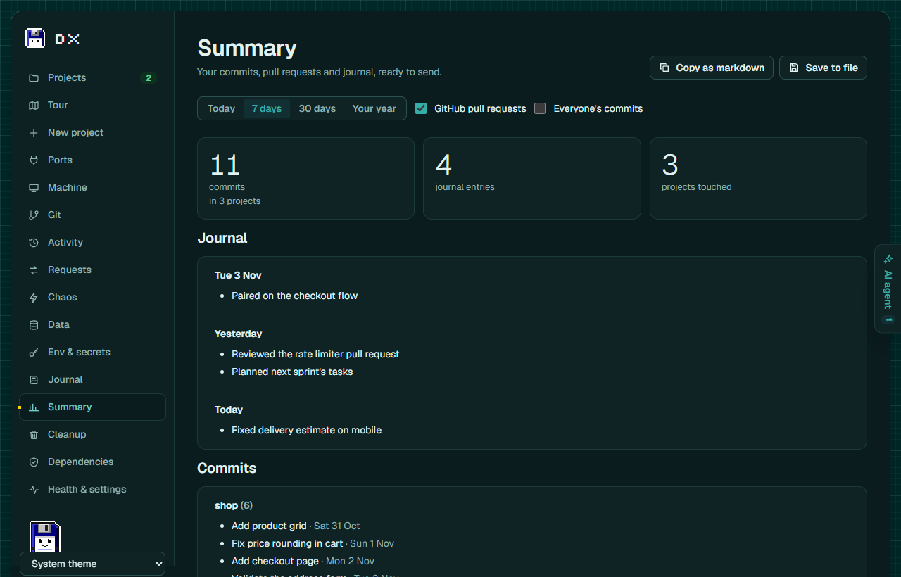
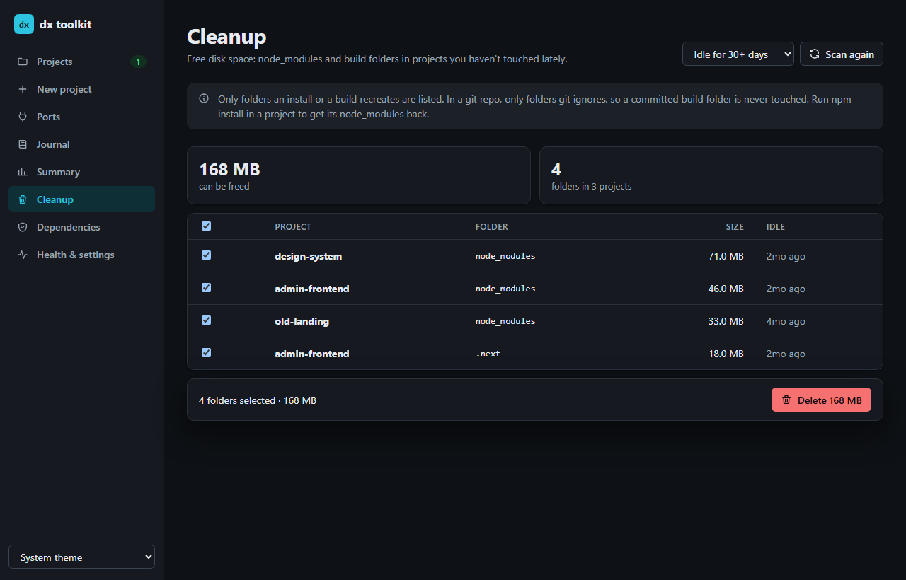

# Features

What dx does, page by page. Back to the [README](../README.md).

## The dashboard: `dx ui`

```powershell
dx ui
```

It opens dx in a window of its own, where everything `dx` does is a button. The sidebar is short and arranged by what you came to do: **pick a project at the top**, and **Projects**, **Git**, **Requests** and **Stress test** are about that project (the choice is remembered, and a link to another project's page switches to it); **Computer** and **Summary** are about everything; **Settings** is at the foot. Pages with nothing in them appear only when there is something to show: **Tools** (once the project has one), **Data** (when a schema is found), **Secrets** (when the project has `.env` problems, with a count), **Agents** (while AI agents run), and **Stress test** while the project's server runs. They are always reachable from Jump to… (Ctrl+K) and by link. The pages used to have other names, and still answer to them there: Code is Git, API and Activity are the two tabs of Requests, Break it is Stress test, Env & secrets is Secrets, This computer is Computer, Look back is Summary, All projects is a tab of Projects.

**The project you picked**

| Page | What you can do there |
|---|---|
| **Projects › This project** (was Overview) | The project's home. **Run** its dev server right in the page and watch its output live, open it in the browser when it's ready, **Stop** it; see its **errors** with file and line, and open your editor at that line; **Ask Claude to fix** an error and review the patch Claude Code proposes before anything changes (see [Ask Claude to fix](#ask-claude-to-fix)); **Check page** loads it in a headless browser and lists exceptions, console errors and failed requests; **Requests** shows what the app sent through its `.localhost` address and what came back; work in it that isn't backed up; **leave a note** for next time; **check its .env** and look for committed keys; **run its tests** and see each failure with file, line, expected and actual; open it in your editor, in **a terminal** (Windows Terminal, PowerShell, Git Bash, iTerm2, Warp, Ghostty and others, whichever you have) or in File Explorer. Its **API spec** (found by itself, see [An API spec on every project](#an-api-spec-on-every-project)), and its **tour**: what it is and what it's built with, how to run it, its pages with the API calls each makes and the file that answers each, its API spec, its data, the settings it needs (names only) and where the work happens, with **Copy the tour as Markdown** (see [Tour](#tour-a-map-of-a-project)) |
| **Git** (was Code) | The project's git, in four tabs by what you came to do, under a branch bar that's always there (Fetch, Pull and Push, force only with lease, and Undo): **Save**, **Share**, **Release** and **History**. See [Code: save, share, release, go back](#code-save-share-release-go-back) |
| **Requests › API** (was API) | The project's **API spec** first (given or found by itself) with a map of what was called and what doesn't fit it, and a **mock server** that answers from the first call, with data from the spec, cached real answers, or written by Claude Code or Codex; then Burp- and Postman-style tools for the app you run: the **Repeater** to edit and resend any request, **Rules** that change a request or its answer on the way (headers, JSON fields, body, status), slow it down or make it fail, and **Intercept** to hold a call and edit it by hand. See [The API page](#the-api-page-spec-mocks-repeater-rules-and-intercept) |
| **Requests › Activity** | Everything that happened in your apps, here and deployed, laid out like opening a project: your projects and recorded sites on the left (with each environment, event and problem counts, and **Open in dx browser** per site), the chosen one's timeline on the right, one line per event, in four views: **Sessions** (each visit's steps: clicks, routes, requests, errors), **APIs** (each endpoint with its calls, payloads, responses, average and slowest time), **Errors** (grouped, with how often and where) and **Console**. Filter by environment (local, staging, production…), or **By AI**: only your AI agent's page checks, with its other calls through dx in between. **Open dx browser** and **Record a site** at the top; a visit on a site that names its deployment shows it, with **Run this commit** when your project has that commit. Every request, error and console line opens **Visual** (status and timing at a glance, JSON as a colour-coded tree that folds, stacks as frames that open your editor) or **Raw** (the exact text). Search payloads and messages, open an error at its line in your editor, **Ask Claude to fix** an exception, server error or console error, **Copy as bug report** on any error, **Download bug bundle** for a teammate to replay, **Open a bug bundle** (or drop the file on the page) to replay one you were sent at its commit, side by side with the original, **Replay** a visit in a headless browser, and **Mock mode**: answer the project's API from what was recorded, with each endpoint's status, delay and body editable (Fail with 500, Empty list, Slow, Offline). See [Replayable bug reports](#replayable-bug-reports) and [Mock mode](#mock-mode). **Time travel**: drag the slider to a moment, see what happened around it, which commit you were on then, and **Run it as it was then**. See [The activity history](#the-activity-history) and [Record deployed sites](#record-deployed-sites) |
| **Tools** | Your own helpers for the project, made by describing them in a chat with Claude Code or Codex (pick the model and the effort), then run by dx the same way every time, with no AI: **views** of an API's answers or the recorded calls (a table, cards, bars, a number, a tree), **watches** that speak up when a call matches (a toast with a sound, Floppy's line), **operations** that send a few requests in order with inputs, and changes to **your app's API answers**, **your app's own pages** (a panel, a section, a table column, a highlight, something hidden) and **dx's pages** (a card on Overview, a column in Activity's API list). Preview, edit, turn off or delete each; **Export** and **Import** carry them all in one file. See [Your own tools](#your-own-tools) |
| **Data** | Realistic, connected data for the development database from its schema, edge cases included, as scenes you switch between in seconds; the data that's there is saved first. **Queries per request**: which database queries each request ran, with N+1 and slow queries named. See [Realistic data](#realistic-data) and [Queries per request](#queries-per-request) |
| **Stress test** (was Break it) | Break the app on purpose, before your users do: **Chaos mode** breaks its API calls the way real networks and servers do (slow, 500s, dropped, logged out, out of order, rate limited, odd data), seeded so a run can be met again, with a report of what the app did about it (blank pages, uncaught errors, stuck spinners, orders sent twice); **Gremlins** click and type through the app at random and bring back the steps to each crash; a fake **Clock** and time zone for the page; a **Weak phone** on 3G in the dx browser; **Languages** (pseudo text and right to left, and a check for text that's cut off or never translated); **Missing values** (which .env values matter); a **Behaviour diff** against an earlier commit; the **Graveyard** of routes and pages nobody used; and **Security**, a friendly attack on your own app. See [Chaos](#chaos-break-the-app-before-your-users-do) |
| **Secrets** (was Env & secrets) | The project's `.env` files (subfolders included): see them with values hidden until you ask, edit and save them, or open them in your editor. Warnings for `.env` files git would commit or already has, no `.gitignore`, and keys in committed files; what `.gitignore` is missing to keep secrets out of git (OWASP), with a button that adds it. **Alerts** for the project: on by default, with the system's notifications or without (see [Alerts when a .env file changes](#alerts-when-a-env-file-changes)) |

**Everything**

| Page | What you can do there |
|---|---|
| **Projects › All projects** | Search your projects; run, stop and open any of them; the dev servers running and the servers your AI agent started; **work that isn't backed up** across all projects; save one as a template; **New project**: create one from a template or a copy of another, with git and packages installed, or **clone a repository** and get it ready to run. A project's name opens its Overview. **Snapshots** (an older commit running, see [Run any commit](#run-any-commit)) show here too, labelled `shop-website @ abc1234`, with their output and errors and **Remove** |
| **Computer** | Four tabs. **Machine**: see below. **Ports**: what's listening, and stop it (it asks first, naming the process). **Cleanup**: which `node_modules` and build folders can go; pick them and delete them (it asks first). **Dependencies**: the audit across all projects (npm, pnpm, yarn and bun) with a progress bar; open a row for its outdated packages, and **Update packages** within their ranges, or **Try it** on one: the upgrade in a throwaway copy, with its type check, build, tests and pages before and after (see [Try an upgrade](#try-an-upgrade)) |
| **Computer › Machine** | **Tools**: Node, npm, pnpm, yarn, bun, deno, git, gh, docker, Python, Go, Java and Rust, each with its version, the newest one, and whether yours still gets security fixes ("Node 18 stopped getting security fixes on 30 Apr 2025"); **Update** opens the right command for how it was installed (nvm, fnm, volta, winget, Homebrew, npm…) in a terminal you can see. **Your projects**: what each project asks for (`.nvmrc`, `engines`, `packageManager`, lock files, `.python-version`, `go.mod`, compose files) next to what's installed, with the command that fixes it. **Running in the background**: dev servers, watchers, AI tools and editor helpers with their memory, CPU and ports, marked **left behind** when the terminal that started them is gone, or **open to your network** when they listen beyond this computer; **Stop** one (it asks first). **Docker**: containers, and the space images, stopped containers and the build cache take, with **Clean up** (never volumes). **Services**: databases that start with the computer, with the commands that stop them |
| **Summary** (was Look back) | Two tabs. **Summary**: your week: commits, pull requests, journal, where the time went, uncommitted work; copy it as markdown or save it. **Your year** tells the year as a story, one card each: commits, active days and the longest streak, the busiest week, a heat map of when you code (weekday by hour), the project of each month, your most-touched files, bugs squashed, the biggest day, languages by files changed, time with dev servers running, your first and latest commit, your journal's most-used words and your AI agent's calls through dx. Pick another year; **Copy as markdown** and **Save** keep the same numbers. Made from your own commits on this computer; nothing leaves it. **Journal**: add what you did, read back 7, 30 or 90 days |
| **Settings** | `dx doctor`'s checks with how to fix each problem, which AI tools are connected (with Connect and Disconnect buttons), your projects folders, editor, terminal and GitHub username, the **theme** (the system's, light or dark), whether to keep the activity history and for how long, **.env alerts** on or off, **Your dx on another computer** (Export everything, Import… with a preview, and Undo; see [Your dx on another computer](#your-dx-on-another-computer)), and what dx ran recently |
| **Agents** | Every AI agent working on this computer, as a node graph: each Claude Code session is a node with the subagents it started hanging off it (and theirs under them), lines pulsing while one works. Each node says who it is, its status (working, waiting for you, idle, done, stopped), model and effort, the project it works in and the tool it runs now; click one for the details: when it started, the branch, its permission mode, the tools it used and how many calls went through dx. Filter by Active, 24 hours or 7 days, and by project. Read from Claude Code's own session files, **metadata only**: never what was said, a prompt, a tool's input or its result. It shows titles, a subagent's one-line task description and the folder each works in. Follows by itself every 3 s. **Where the effort goes**: how long each session and subagent has run, a bar of its tool calls over the last hour (the part through dx in the accent), and a flag on an agent that has been on one tool call for 10 minutes with nothing new (it may be hung, or waiting for you to approve it). **Waiting for you**: when a session has finished its turn (or asked you a question) and sat for 90 seconds, dx warns you with a toast and a sound, a system notification and a line beside Floppy ("shop-website: agent waiting 4 min") until you answer; a stuck agent warns too. Turn it off in Settings, or per project on its Env & secrets page |
| **Jump to anything** (every page) | Ctrl+K (⌘K on a Mac), `/` or the "Jump to…" button opens a list: type to find a page, a project to switch to, or "Run <project>"; Enter chooses, Esc closes. `?` lists the keyboard shortcuts |
| **AI lane** (every page) | While an AI agent works through dx (a call in the last 5 minutes, or a server it started still running), a panel slides in at the right edge with a live feed of what it does: "Started shop-website's dev server", "Loaded /checkout on shop-website: 2 errors", "Read shop-website's activity log", each linking to the dev server's card, the Activity page (filtered **By AI**) or the page it touched. **Interrupt** stops every dev server the agent started, after naming them (dx can't stop the agent itself; tell it to stop in your AI tool). **Take over** makes a server the agent started yours. Collapse it to a tab; that's remembered |

| Summary | Cleanup |
|---|---|
|  |  |

- **It runs on your computer only**, at `http://dx.localhost` (or `http://127.0.0.1:4646`). Every action needs a secret the page gets when it loads, so other websites can't use it.
- **It's started for you when needed.** When an AI tool asks dx to run a dev server, dx starts the dashboard in the background; `dx ui` then just opens it. A background dashboard stops itself after 30 minutes with no dev servers running and nobody using it. `dx ui --stop` stops it now.
- **After you update dx**, the next `dx ui`, the dx app or an AI tool using dx replaces a background dashboard left from the older version with the new one, and starts the dev servers it was running again. Nothing to stop or restart by hand.
- **Dev servers you start from the dashboard stop when the dashboard stops**, like a dev server stops when you close its terminal. For one that keeps running, use **More → Run in a terminal window**.
- Light and dark follow your system, or pick one in Settings. It works on a phone-sized window too.
- **The look**: the app sits like a window on a teal desktop with a faint pixel grid, with Floppy as the logo. Its fonts (Geist, Geist Mono and Silkscreen, all under the SIL Open Font License) ship with dx in `packages/web/public/fonts`, so nothing loads from the internet.
- `dx ui --port 5000` runs the dashboard in this terminal on another port; `dx ui --no-open` runs it in this terminal without a window; `dx ui --browser` opens it in your browser this once. From the project folder, `npm run ui` does the same as `dx ui`.

### The dx app

dx is an app: its own window, Floppy as its icon on the taskbar (or Dock), an entry in the Start menu you can pin, and it opens when you sign in. Floppy comes with it.

- **The first `dx ui` gets it ready.** The window is [Electron](https://www.electronjs.org/), a 100 MB download (about 370 MB installed) that dx installs once into `~/.dx/app`, one pinned version, so `npm install -g dx-devkit` stays small. Until it's there, or if it can't download (set `ELECTRON_MIRROR` behind a firewall), dx opens as an Edge app window, then in your browser. It's named dx everywhere the system looks: on Windows the program is `dx.exe`, a copy of Electron's with dx's name and Floppy's icon written in (by [rcedit](https://github.com/electron/rcedit), installed with it), so Task Manager, the Startup apps list and the taskbar say dx; on macOS it's `dx.app`, with its name, id and icon set and signed again for this computer; on Linux its launcher entry (`~/.local/share/applications/dx.desktop`) names it in menus and the dock.
- **Electron updates come with dx.** Each dx release pins the newest Electron with its security fixes; the next time dx opens, it installs that one next to the one running (in the background when the app opens by itself, in front of you with `dx ui`), and the app is on it the time after. The old one is removed once nothing runs from it. The open window never has to close for it.
- **The dashboard runs behind it, in the background**, so the terminal is free. Close the window any time: dev servers keep running, and the dashboard stops by itself 30 minutes after the last one stops. `dx ui --stop` stops it and its dev servers now; the window then says dx isn't running, with **Start dx**.
- **It opens when you sign in**, on the taskbar or Dock rather than in your face: the first `dx ui` adds a shortcut to your own Startup folder on Windows, a LaunchAgent on macOS (`~/Library/LaunchAgents/dx.dashboard.plist`), or an autostart entry on Linux (`~/.config/autostart/dx.desktop`), none of which needs admin rights, and says so. `dx ui --no-startup` removes it, `dx ui --startup` puts it back; Windows' own Startup apps settings show it too. On Windows the app adds itself to the Start menu, so you can open dx by typing its name and pin it to the taskbar.
- **It shows the dashboard and nothing else.** Only the dashboard's own address on this computer loads in the window, with the same token and checks as in a browser. Links to your apps, GitHub and anything else open in your browser. The page has no access to Node or your files, and no permission except the clipboard, for the Copy buttons.
- **It's laid out like an app**: the page scrolls inside the window and the sidebar stays put, scrolling on its own if the window is short.
- **It remembers its size and place**, and opens on a screen you still have. Ctrl+R reloads, Ctrl+Shift+I opens the developer tools, Ctrl+plus and Ctrl+minus zoom.
- `dx ui --remove-app` removes the app (its folder and shortcuts); `dx ui` then opens the dashboard in your browser, until `dx ui --app`.

---

## Floppy, on your desktop

Floppy sits on your desktop, just above the Windows taskbar or the macOS Dock (or at the bottom of a Linux desktop): the save icon come alive, 48 pixels tall. It comes with [the dx app](#the-dx-app) (or `dx floppy` on its own), shows what dx is doing, and clicking it opens the app.

- **Its moods follow dx.** Idle, it blinks and looks around. A project starting: it watches a progress bar fill on its label, with the preparing step in its balloon. A server comes up: it hops once. An error: red eyes, a shake and a balloon naming the file and line, until you click it. An AI agent at work: it watches a sparkle. Thirty minutes with nothing happening, or **Quiet for an hour**: it sleeps (errors still wake it).
- **A line beside it says what's going on**, so you don't have to read its face: `todo-app running`, `shop-website: Install packages…`, `todo-app: error in cart.ts:42`, `AI: Checked /health on api-gateway: 200`, `Nothing running`, with a coloured dot (green running, blue starting, red an error, purple the AI, grey quiet). Errors you've already looked at stay counted there (`todo-app running · 1 error`).
- **Hover** it or the line for its balloon; **drag** it along the taskbar (it remembers where); **right-click** for Open dx, Quiet for an hour, Start with Windows (Open at login on macOS, Start when you sign in on Linux), and Quit.
- **It starts when you sign in.** The first `dx floppy` adds a shortcut to your own Startup folder on Windows, a LaunchAgent on macOS (`~/Library/LaunchAgents/dx.floppy.plist`) or an autostart entry on Linux (`~/.config/autostart/dx-floppy.desktop`), none needing admin rights, and says so; `dx floppy --no-startup` or the menu removes it.
- **It gets out of the way** while a game, a video or a presentation is full screen (on macOS it stays off full-screen spaces).
- **It doesn't keep dx running.** It reads the dashboard's state every two seconds without counting as someone using it, so a background dashboard still stops when idle; a click starts it again.
- `dx floppy --stop` (or **Quit** in its menu) takes it off, and the app doesn't bring it back until `dx floppy` or **Run Floppy**, the button beside the Floppy at the bottom of the dashboard's sidebar (shown while Floppy isn't on the desktop); `--colour charcoal` or `maroon` changes its colours, `--status` says whether it's running.

On Windows there's nothing to install: the window is Windows PowerShell and WPF, which every Windows 10 and 11 has. On macOS and Linux it's a transparent window of the Electron [the dx app](#the-dx-app) uses (installed once if the app isn't there yet), with no Dock or taskbar button, that lets clicks through everywhere but Floppy, its balloon and its line. Linux needs a desktop with a compositor for the see-through part.

---

## The activity history

Every app you open at its `.localhost` address (the address `dx up`, `dx go` and the dashboard give you), and every deployed site you use in the [dx browser](#record-deployed-sites), leaves a history of what happened, in order:

- **Requests** with their method, address, status, time, and what was sent and returned;
- **Pages** loaded, and **route changes** without a page load (`/cart → /checkout`);
- **Clicks** on buttons and links, and **forms** submitted. What you type is never recorded;
- **Console output** (`console.log`, `warn`, `error`) with the file and line that wrote it, and **uncaught errors** with their stack;
- the **dev server** starting, getting ready, stopping and crashing, and each **error it printed**.


See it on the **Activity** page, with `dx activity`, or ask your AI agent (`activity_log`). On the Activity page:

- **Sessions**: each visit (one page load in a tab) with everything that followed it: the clicks, the requests they set off, and the errors in the browser and on the server.
- **APIs**: every endpoint your app called (`GET /api/cart/:id`, ids folded together), with how many calls, how many failed, the average and slowest time, and each call's payload and response.
- **Errors**: exceptions, console errors, failed requests and server errors, grouped by message, with how often, when first and last, and where in the code.
- **Console**: your app's console output, newest first, repeats folded into one line with a count.
- **Copy as bug report** on an error copies markdown for an issue or an AI chat: the steps that led there, what went wrong, each request with what was sent and returned, and the stack.
- **Replay** a visit: dx opens the page it started on in a headless browser, clicks what you clicked in the same order, and lists what broke. Run it again after a fix to see the problem gone. Your AI agent can do the same with `replay_visit`. What you typed isn't recorded, so fields stay empty.

Nothing to set up:

- **How it's recorded.** Requests go through the local domains proxy, which logs them. For the browser side, the proxy adds one `<script>` tag to your app's HTML pages, served from your app's own address. Browser dev tools leave it out of stack traces, so `console.log` still shows your file and line. Requests the page makes to `localhost:<port>` or other addresses are recorded by that script.
- **At `localhost:5173` too, in any browser.** When dx starts an app whose tool it knows (Vite, Next.js, Astro, Nuxt, Angular, webpack, Gatsby, Create React App), dx answers at the app's usual address itself and runs the dev server on a free port behind it, so the address you always open is recorded. Live reload passes through. If the port is taken, or the dev script is something dx doesn't know (a custom command, several processes, a port of its own), the app runs as before and only its `.localhost` address is recorded. `"localhostRecording": false` turns this off.
- **Private.** Passwords, tokens, cookies and API keys are masked before anything is written. It's kept in `~/.dx/activity`, readable by you only, for 7 days (`activityDays` in the settings).
- **Bounded.** At most 500 MB in all (`activityMaxMB`), the oldest days going first. A project's day keeps everything up to 100 MB; past that, events are kept without their bodies, and past 200 MB only errors are kept. An app that polls every second can't fill your disk. Settings shows how much it takes. Only the page itself can add to its history; no other website can. `dx activity --clear` or **Clear history** deletes it.
- **Off**: untick it in Settings, or set `"activity": false`. Pages are then served exactly as your dev server sends them.

## Replayable bug reports

**Download bug bundle** on an error (or on a visit with problems) saves one file, `shop-website-abc1234-20261104-1530.dxbug.json`, that a teammate opens to see the bug happen on their own computer.

- **What's in it**: the visit's steps (each click, waiting for the page it led to), the requests around the error with what was sent and returned, the console output and errors, the error itself with its stack, the project's name, the commit you were on when it happened (from git's reflog) with its branch, and whether your working copy had uncommitted changes.
- **What isn't**: no address of your computer (hosts and ports are dropped; only paths like `/cart` are kept), no cookies, tokens or authorization headers (only plain headers like `content-type`), no `.env` values, and no folders of yours: paths in stacks are made relative to the project (`src/cart.js:12`), your home folder becomes `~`. Bodies are masked when recorded and masked again on export.
- **Open a bug bundle** on the Activity page (or drop the file on it), pick the project (the one with the bundle's name is picked for you), and **Replay**. dx runs the bundle's commit as a snapshot ([Run any commit](#run-any-commit)), or your working copy if you choose, waits for its dev server, and does the steps in a headless browser. **Then** (the original error, its steps and everything recorded, in the usual viewers) sits next to **Now**: "Reproduced: the same error at src/cart.js:12", or "Not reproduced", with each step and what broke.
- **Checked before anything runs.** A bundle is at most 2 MB, of version 1, with only the fields a bundle has; its commit must be a hash your repository has; its steps may only click, type, press, wait and go to paths. The bundle's own host is never used: the steps run on your dev server for the project, and a step pointing at another computer is refused.
- In the terminal: `dx bug export shop-website <event-id> [file]` (ids are in `dx activity --json`) and `dx bug replay <file> [project]` (`--working` for your working copy).

## Mock mode

Run your front end without its back end: dx answers the project's API calls from what was recorded.

1. Use the app at its `.localhost` address (or the address dx records) with the back end running, so its API calls are in the history.
2. **Make mocks from the last hour** in the Activity page's **Mock mode** panel, or **Make mocks** on one visit (`dx mock make shop-website --since 1h`).
3. **Turn on** (`dx mock on shop-website`). The project's Overview and the Activity list show **Mocked: 12 endpoints** while it's on.

- **What's mocked**: API calls (`fetch` and XHR, any method), matched by method and path with ids folded the way the APIs view folds them (`/orders/42` and `/orders/77` are both `/orders/:id`), and by query or request body where the recorded calls differed by them; otherwise the most recent answer wins. Page loads, scripts, styles and images always come from the dev server.
- **Calls with no mock** go to the dev server as usual. With **Strict** (`dx mock on --strict`), dx answers them with a 404 instead, so you see what the front end calls that you have no recording for.
- **Edit** an endpoint: its status, a delay (up to 30 s), the content type and the body, in an editor that checks the JSON and shows it as a tree. Quick presets: **Fail with 500**, **Empty list**, **Slow (3 s)**, **Offline** (the connection closes with no answer), **Reset to recorded**. Each endpoint can be turned off on its own. An endpoint you edited isn't replaced when you make mocks again.
- **Masked stays masked.** The bodies are the recorded ones, and the recording masked passwords and tokens: they come back as `•••`.
- **Honest history.** Mocked answers are in the network log and the activity history marked **mocked**, and carry an `x-dx-mock: 1` header.
- **Only in dx's proxy.** Mocks apply only to requests that reach dx's own proxy for a dev server dx runs; nothing else is changed, and a mock can't send a request anywhere. They're kept per project in `~/.dx/mocks`, readable by you only. `dx mock list|off|clear <project>`.

## An API spec on every project

dx keeps an OpenAPI or Swagger spec with each project, and finds it by itself: a spec file in the project (`openapi.yaml`, `swagger.json`, `docs/api.openapi.json`… three folders down), or, while dx runs its dev server, the running app's usual address (`/openapi.json`, `/v3/api-docs`, `/swagger.json` and others). A file is read fresh each time, so edits show. You can also give it one on the API page: a file in the project, an address on the running app, or pasted. Remove it there and dx doesn't look for one again until you give it one.

**A project can have several APIs.** Add another on the API page (**Add another API**: a file in the project, the running app, or pasted), or with `dx mock spec <project> docs/payments.yaml --name payments`. Each is its own API with a name: its endpoints and its mocks know which API they're from, so two APIs with the same path (both have `GET /health`) keep their own mocks and calls. When two APIs can't be told apart, dx names the endpoints they share; tell it which **service** each is (in a stack) or where each is **served** (`/payments`, when that isn't the spec's own base path) and they stop competing. **Make mocks** works per API or for all, and a mock made again replaces only that API's. Removing one API leaves the others.

Once a project has them, the rest of dx uses them:

- **Overview** shows each API: its title and version, where it came from, how many endpoints were called this week, and calls no API has.
- **Activity**'s APIs view names each call by its endpoint ("The cart's items") and its API (when there are several), marks calls no spec has and answers that don't match it, and lists the endpoints that weren't called.
- **The tour** lists the API it describes, next to what was called.
- **API**: the map of endpoints, and mocks made from its examples and schemas.
- **Break it**: its endpoints count as declared routes for the graveyard of unused ones.
- **AI agents** get it through dx's `api_map` tool.

## Your own tools

Each project can have tools of its own, on its **Tools** page. Describe one in the chat ("show the latest /api/orders answer as a table of customer, total and status, failed ones in red") and Claude Code or Codex, whichever you have, makes it; the model and the effort are picked beside the chat. What comes back isn't code: it's a definition made of dx's building blocks (where the data comes from; steps such as get, filter, map, sort, group and count; how to show it), checked by dx before anything is kept. From then on dx runs it the same way every time, with no AI. You can edit the definition by hand, then **Use this**.

- **Views**: an API's answer (asked of the dev server dx runs) or the calls in the activity history, as a table, cards, bars, a number, a list or a tree, with rows highlighted by a rule. **Pin** one to the project's Overview.
- **Watches**: a rule on what the app does (a 500, a slow call, a field with a given value), with a toast and a sound in dx and a line beside Floppy.
- **Operations**: requests sent in order, with inputs you fill in and values carried from one answer to the next (`{{token}}`), checked against what you expect, repeated if you like.
- **Your app's API answers**: fields added, worked out or removed in matching JSON answers on their way to the app, while it's used through dx. Marked `tool: <name>` in the history; **Turn off** gives the app the real answer again.
- **Your app's pages**: a floating panel, a section, a column in one of its tables, a highlight or something hidden, on the app's own page while it's used through dx. The app's code isn't touched.
- **dx's pages**: a column in Activity's API list (the slowest call, the average, a field's last value…).

Tools are kept in `~/.dx/tools`, one file per project, readable by you only. **Export** saves all of a project's tools in one file (their requests' headers and bodies as written, so share it with care); **Import** adds a file's tools to another project after showing what's in it. In a chat, a tool's credential headers (Authorization, cookies, API keys) are hidden from the agent and put back in what it answers. From the terminal: `dx tools <project>`, `dx tools export <project>`, `dx tools import <file> <project>`.

## Alerts when a .env file changes

dx warns you when a project's `.env` file changes, is staged, or goes into a commit: a toast with a sound in dx, and a notification from the system (Windows, macOS or Linux), so a secret doesn't slip into git unnoticed. A staged or committed one says how to take it back out. It's on by default; turn it off for every project in **Settings**, or on a project's **Env & secrets** page turn off its alerts, or only the system's notifications.

## Your dx on another computer

Two computers, one setup. On the first, **Export everything** in **Settings** (or `dx state export`); on the other, **Import…** that file (or `dx state import <file>`). The file holds:

- your settings (editor, terminal, activity history, alerts…), the projects folders under your home folder, and the sites you record;
- your journal, saved summaries and `dx new` templates;
- for each project: its tools, mocks, rules, API spec, chaos settings, data scenes, note and alert choices;
- the dashboard's preferences (the theme, Visual or Raw…), when it's made from the dashboard.

Live things stay where they are: commits and branches (git carries those), the activity history and run log, snapshots, screenshots, caches, the dx browser's sign-ins, `.env` files and the dashboard's secret. Projects are named by their git repository and folder name, never by a path, and found again the same way on the other computer; you can pick another project for one, or leave it out.

A project in the file that isn't on this computer but has a repository shows **Clone it here** on the import preview (or `dx state import <file> --yes --clone`): dx clones it from its address (https, no sign-in details) into your first projects folder, and nothing is installed or run, since the file isn't code to run installs for. Set it up from All projects when you want to run it.

Before anything is written, dx shows what would change. Where both computers have something, the file's wins, and nothing is deleted; mock mode and Chaos mode stay switched as they are. Templates go into this computer's own templates folder. Every file is backed up first, so **Undo** (or `dx state undo`) puts it all back, and an import that stops part-way is put back by itself. The file holds your mocks' answers and saved data scenes, so keep it to yourself.

## Code: save, share, release, go back

The project's git, in four tabs under a branch bar that's always there: the branch, how far it is ahead of or behind its remote, **Fetch**, **Pull**, **Push** (force only with lease) and **Undo**. Every step can be undone, from the Undo button or the Undo history, and git's reflog is there to go back further. Drag and drop works everywhere, and every action also has a button. Changes made in your editor or a terminal show up by themselves.

- **Save**: the project's changes as cards. Drag them from **Changes** to **Staged** (or press the arrow on a card; Ctrl+click and Shift+click pick several), open one to see its changes side by side and **stage one block** at a time, write the message and **Commit**; amend the last commit. With Claude Code installed, **Write message** has it write the commit message from what's staged, in the repository's own style, for you to edit (it sends the staged diff to your Claude account, only when you click). A **Shelf** to put changes aside and take them back (stash), and a bin to discard them. A commit stays on your computer until you push. When a merge or rebase stops on **conflicts**, this tab opens: each conflicted file side by side, with Keep yours, Keep incoming or Keep both per block, then Continue or Abort.
- **Share**: branches, created, switched, renamed and deleted. A branch's menu (or dragging it onto yours) merges it into the one you're on, with a preview of the commits and the files that would conflict (Merge, Squash or Fast-forward), or rebases yours onto it. **Proof for the pull request** writes how the branch was tested, to copy or add to its pull request (see [Proof for the pull request](#proof-for-the-pull-request)).
- **Release**: **New release** suggests the next version from the last tag (a minor bump when a commit since adds something, else a patch), a title, and notes written from the commits since, all editable; Draft and Pre-release. **Create release on GitHub** tags the commit you're on (or uses the tag you name), pushes the tag, and creates the release through the GitHub CLI (`gh`) you already use, only when you press it and after saying what it will do. **Only tag it** makes the tag without a release. GitHub's releases are listed, and **Tags** are made, pushed (one, or all) and deleted here. Without gh, signed out, or for a repository that isn't on GitHub, the tab says why and still makes and pushes tags.
- **History**: the **history as a graph**: it draws itself in, lights up a branch's path under the mouse, shows each author's initials in the dots and branch pills in their lane's colour. Open a commit for its message, its diff (**Visual** side by side, or **Raw**) and what you can do with it: **Run this commit**, Revert, Copy onto this branch (cherry-pick), New branch here, Tag, Edit history from here (reorder, reword, squash, fold or drop, as cards) and Go back here. **Search commits** by message, hash, author or a file they changed, and **Run this commit**: the app as it was, next to your own dev server (see [Run any commit](#run-any-commit)). **Visual diffs**: while dx runs the dev server, each commit gets a small screenshot in its row, and an **orange ring** on its dot when it changed how the app looks; open it for **before and after** as a wipe you drag, side by side, or the changed pixels, with "3% of the page changed, around the Checkout button" (see [Visual diff](#visual-diff)), and **Capture now**. The **Undo history** is here too.

## The API page: spec, mocks, Repeater, Rules and Intercept

What Burp Suite and Postman do for an API, for the app you're running, with nothing to set up. It works on the project picked at the top of the sidebar.

- **Rules** (match and replace): for a method and path (`/api/orders/*`, `/api/**`, `/api/search?q=*`), change the request (set or remove headers, change JSON fields like `items.0.qty = 5`, replace the body) or the answer (status, headers, JSON fields, body), add a delay, make it **fail** with a 500, **never answer**, or **drop the connection**. Rules apply in order to calls through dx (the `.localhost` address, or the address dx records); each changed call is marked in Activity with the rules that changed it, and each rule shows how often it matched. **Make a rule** on any request in Activity starts one for its endpoint.
- **Intercept**: a rule set to **Hold** catches matching requests, their answers, or both. Edit the method, address, status, headers or body, then **Send on as edited**, **Send on unchanged**, or **Drop**. Held calls are in memory only and go on by themselves after a minute, so the app never hangs.
- **Repeater**: send any request to the project's dev server and see the answer Visual or Raw, with its time and size. **Edit and resend** on any request in Activity opens it here. What you send isn't changed by rules or mocks. Values dx hid when it recorded them (tokens, cookies) show as `•••`: type the real ones; the history of what you sent keeps them masked.
- **API spec**: dx finds an OpenAPI or Swagger file in the project (JSON or YAML), reads one from the running app (`/openapi.json`, `/v3/api-docs`, `/swagger.json`…), or takes one you paste. The **API map** lists every endpoint with its calls and statuses from the last 7 days, answers that don't fit the spec (`price is text, the spec says a number`, a missing field, an undeclared status), and calls that aren't in the spec.
- **Mock server**: the project's mocks at an address of their own, `http://localhost:4010` (or the next free port) and `http://<project>.mock.localhost`, answering **from the first call, with or without the back end**, like a Postman mock server. Mocks come from:
  - the **spec**: its examples, or data made up from its schemas (product names for products, people for users, dates, prices, emails at example.com), the same each time;
  - the **cache**: turn on **Keep real answers** and every answer from your real server is kept as a mock, until you **purge** it;
  - **recordings** from the Activity page;
  - **Write data**: Claude Code or Codex, whichever you have installed and signed in, writes realistic data for one answer, fitting the spec. Only on a click, with your own account; no API keys.

  Real answers beat made-up ones; ones you edited beat both. Pick an answer per request the way Postman does: `x-mock-response-code: 404`, or `x-mock-response-name: <example>`. Pages on this computer can call it (CORS); sites elsewhere can't. A running mock server starts again with the dashboard, on the same port.

From the terminal: `dx mock spec shop-website [docs/openapi.yaml]`, `dx mock server shop-website on|off`, `dx mock cache shop-website on|off`, `dx mock purge shop-website [cache|spec|generated|ai|recorded]`.

## Chaos: break the app before your users do

The **Chaos** page (and `dx chaos`) puts the app through what real life does to it, on this computer only:

- **Chaos mode** breaks the project's API calls as they pass through dx (its `.localhost` address, or the address dx records) the way real networks and servers break them: **slow** answers, **500s**, connections **dropped** halfway, a **401** halfway through as when a session expires, answers **out of order** (the older search lands last), **429** rate limits, and **odd data** (a field comes back `null`, an empty list, `-1` or 10,000 characters long). Pages, scripts and styles always load. Pick how bad: **Bad Wi-Fi**, **Monday deploy** or **Black Friday**, or tick the faults you want; `Only these calls` narrows it to a path pattern. It's **seeded**: seed #4812 breaks the same calls the same way every time, and **Start the run again** counts from zero, so a crash can be met again. **What broke** lists what the app did about it, each with the chaos that hit it first: **pages that went blank**, **errors nothing caught**, **loading indicators that never stopped** (15 s), and **the same order sent twice** (a submit that doesn't stop a second click). Each opens the visit in the history.
- **Gremlins**: a headless browser goes through the app by itself, like an impatient person: clicks whatever it finds, types nonsense into fields (empty, 5,000 characters, emoji, `<script>`, `'; DROP TABLE`), double-clicks submit, presses Enter, goes back halfway. Controls that look destructive (delete, sign out, reset) are left alone unless you say otherwise. Each problem comes with **the steps that led to it**, to **Replay** or copy. Seeded too; with Chaos mode on, its calls are broken as well.
- **Clock**: the app's pages see another time and time zone: `Date`, `Date.now()` and date formatting. Presets for New Year's Eve, a leap day, the clocks going forward and back, UTC+14 and UTC−11, and 2038. Optionally frozen. Timers keep their pace and the dev server keeps the real time.
- **Weak phone**: every tab of the dx browser, and Gremlins, as a cheap phone in a tunnel: a 390 × 844 screen with touch, a CPU 6× slower and a 3G connection.
- **Languages**: how the app holds up in other languages before anyone translates it. **Pseudo text** makes every text on the app's pages longer and accented, the way German or Finnish run longer than English ("Save" becomes "[Šàṽé ~~~~]"; a missing `]` means something cut the end off), and **Right to left** flips the page as Arabic and Hebrew readers see it; both apply to the app in your own browser through dx, and nothing in the project changes. **Check the pages** loads each page as it is, with pseudo text and right to left in a headless browser, and reports text that's **cut off** or **spills out of its box** (outlined in a picture of the page), and text that **isn't in the project's translation files** (JSON, YAML or .po in folders like `locales/` or `messages/`, with `{{placeholders}}` and ICU plurals understood), so it would never be translated, with the file and line where it's written. Text from the app's own API answers is data, and left out.
- **Missing values**: which `.env` values actually matter. dx starts the app on a port of its own once as it is, then once per value with only that value blank, checks a page each time and compares: values whose absence **crashes** the app, values whose absence **breaks the page** (and how), values **nothing notices**, and values the code **never uses**. Your running dev server keeps running and `.env` isn't changed.
- **Behaviour diff**: your working copy and an earlier commit side by side (the commit runs as a snapshot): the same pages loaded on both and their API calls, answers, errors and warnings compared. *"GET /api/me is called 3 times, was 1; new warning: prices are cached."* A regression test nobody had to write; visual diffs show what changed on screen, this shows what changed underneath.
- **Graveyard**: API routes the code declares (Express, Fastify, Hono, Next.js, SvelteKit, Nuxt, FastAPI, Flask, and the saved API spec), pages from file-based routing and router paths, and mocks, that nothing used while dx was watching. Dead code from what actually ran; it's as long as the history dx keeps (`activityDays`).

From the terminal: `dx chaos on shop-website --level deploy --seed 4812`, `dx chaos shop-website` (what broke), `dx chaos off`, `dx chaos clock shop-website 2026-12-31T23:59:50 --zone Pacific/Auckland`, `dx chaos phone shop-website on`, `dx chaos languages shop-website pseudo` (or `rtl`, `both`, `off`; without one it checks the pages), `dx chaos gremlins shop-website --actions 60`, `dx chaos env shop-website`, `dx chaos diff shop-website --commit abc1234`, `dx chaos graveyard shop-website`. AI agents get the same through the `chaos_mode`, `run_gremlins`, `behaviour_diff`, `env_values_that_matter`, `translation_check` and `find_unused` MCP tools.

## Realistic data

The **Data** page (and `dx data`) fills a project's development database with believable, connected data in one click, from its schema: a Prisma schema, or `CREATE TABLE` in its SQL migrations.

- **Recipes**: **Typical** (a dozen users, each with a few of everything, and the edge cases that break apps: one with nothing yet, a 200-character name, emoji, missing optional values, a deleted user who still has orders), **Big customer** (one user with 60 of everything: long lists and paging), **First-time user** (empty states everywhere) and **Empty**. Seeded, so the same seed makes the same rows. Emails are at example.com.
- **Scenes**: a recipe makes a named scene; **Save the data that's there** keeps the database as one too ("Demo for Friday"). **Load** switches to a scene in seconds.
- **Never a loss**: before a scene goes in, the data that's there is saved as a backup scene (the newest five are kept), so you can load it back.
- **Only a database on this computer**: through the project's own Prisma client (any database Prisma supports, when `DATABASE_URL` is localhost, a Docker service or SQLite), or the Postgres or MySQL its docker-compose runs. Anywhere else, dx says so and leaves it alone. Postgres counters are moved past the ids a scene used. SQLite without Prisma and MongoDB aren't supported yet.
- From the terminal: `dx data todo-app`, `dx data make todo-app --recipe big-customer`, `dx data load todo-app big-customer-1234 --yes`, `dx data save todo-app "Demo for Friday"`. AI agents use the `realistic_data` MCP tool. Scenes are kept under `~/.dx/data`, readable by you only.

## Attack my app

**Security** on the Break it page (and `dx attack`) is a friendly security pass on your own app, on this computer only. It takes the requests and pages in the project's history and tries the usual weaknesses against its dev server:

- **Script that comes back unescaped**: in the address (reflected), and saved through the app's own forms then shown on its pages (stored), checked in a headless browser, so it's only reported when the page really turned it into HTML;
- **Calls that work without signing in**, and with your session, **another record's id** that opens too;
- **Requests from another site** that still go through with your cookie (CSRF), and **CORS** that lets any site read answers;
- **Cookies** without HttpOnly or SameSite (the history now keeps a cookie's name and flags, never its value), and **missing security headers**;
- **Stack traces** and **SQL errors** in answers to malformed input;
- **Logins** that take 20 wrong passwords in a row.

Each finding has the request that shows it, what to fix, and the route's file and line when dx finds it. To test signed-in calls, paste a session (the Cookie or Authorization value from your browser's dev tools): it's used for that run only, never stored or logged. It sends a few test records and wrong passwords to your development database; **Only checks that don't change data** skips those. `dx attack todo-app [--cookie …] [--read-only]`, and the `security_check` MCP tool.

## Your real phone as a test device

**On my phone** on a running project's card (and `dx phone <project>`, which draws the QR code in the terminal) opens the app on your own phone over Wi-Fi: scan the code with the phone's camera. What the phone does (console output, errors, taps, requests) shows up on the card and in Activity, labelled **phone**, so you see what iOS Safari or a real Android does without cables or remote debugging.

It's the one place dx listens beyond this computer, so it's narrow:

- **Only on request, for one project, for 30 minutes** (up to two hours), and only on this computer's own address on the local network.
- **A one-time link**: opening it trades its code for a cookie only this session accepts, and the link stops working; anyone else gets a page saying to scan the code on the dashboard. **New code** lets the next phone in.
- **Only to the project's own dev server**: never the dashboard, never another address. dx's cookie isn't passed to the app.
- It closes when the time is up, when you press **Stop**, when the dev server stops, or when the dashboard closes. Your computer may ask once whether Node.js can accept connections on private networks: allow it for the phone to connect.

Calls the page makes to `localhost` addresses can't reach your computer from the phone; same-site calls go through dx like any other.

## Tour: a map of a project

The **tour**, at the bottom of a project's Overview (and `dx tour <project>`), is a map of a project for someone new to it, or for you in six months, made from its files and from what dx saw it do. Nothing runs and nothing is written.

- **What it is**: the README's first paragraph, and what it's built with (Next.js 14, React 18, Prisma, Tailwind CSS…).
- **Running it**: what dx does before the first start (packages, `.env`, Docker, migrations), the command, the services of a stack, and how it's tested.
- **Pages, and the calls each one makes**: pages from file-based routing and router paths, each with the API calls made while it was open (from the activity history), and **the file that answers each call**. Calls the code declares and nobody made are listed too.
- **API spec**: when the project has one (see [An API spec on every project](#an-api-spec-on-every-project)), its endpoints with what each does and how often it was called.
- **Data**: the database's tables and what belongs to what, from the Prisma schema or SQL migrations.
- **Settings it needs**: the names from `.env.example` (or the `.env` files); values are never read into the tour.
- **Where things are** (folders and what they're for) and **where the work happens** (the files changed most in the last 90 days).

**Copy as Markdown** for a wiki or the repository; `dx tour shop-website > TOUR.md` keeps it as a file. AI agents read it with the `project_tour` MCP tool before they change a project they don't know.

## Proof for the pull request

**Proof for the pull request** on the Code page's Share tab (and `dx proof`) writes the "how was this tested" part of a pull request from what dx saw while the branch was worked on, instead of "tested locally":

- the **last test run** and its result;
- the **pages you tried** by hand and how many different API calls they made;
- **errors** seen while testing, and which still came up after the last commit;
- what the [visual diff](#visual-diff) found on the branch's commits: pages that **look different** (and where), pages that got **slower**, new **accessibility** problems and ones fixed;
- dx's other checks run on the branch: Gremlins, behaviour diffs, the security pass, the translation check, upgrades tried, missing settings;
- how it was **built with AI**: the agent sessions and subagents that worked in the project while the branch was made (and the models), the calls they made through dx, and how many times the tests were run ("2 agent sessions with 1 subagent (opus-5-5), 14 calls through dx, tests run 3 times"). Counts only: nothing of what was said.

**Copy as Markdown**, or **Add to the pull request**, which puts it into the branch's open pull request through the GitHub CLI you're signed in to (`gh`), between dx's own markers, so running it again replaces only dx's part of the description. It asks first; nothing goes to GitHub otherwise. `dx proof` prints it, `dx proof --pr` adds it, and the `pr_proof` MCP tool gives an agent the text (it doesn't change the pull request).

## Try an upgrade

**Try it** next to each outdated package on the Dependencies page (and `dx try <project> <package>[@version]`) upgrades it in a throwaway copy first, so you know what breaks before your own copy is touched:

1. dx copies the project as it is now (uncommitted changes included) under `~/.dx/snapshots`, with its packages linked from the project;
2. runs its type check, build and tests there, as it is;
3. installs the new version in the copy, with its own packages (never in your `node_modules`), and runs them again;
4. starts the copy's dev server next to yours and compares the most visited pages: **how they look**, **what they call and answer**, **errors**, **speed** and **accessibility**.

*"react 18.3.1 → 19.1.0 breaks something: the type check fails (src/Cart.tsx: Type 'string' is not assignable…); 2 more tests fail; /checkout looks different around the Pay button."* Major versions are where it pays off. The copy stays in **Run any commit** to open or remove. `dx try shop-website react@19`, and the `try_upgrade` MCP tool.

## Queries per request

**Queries per request** on the Data page (and `dx queries <project> on`) shows which database queries each request ran, for the Postgres or MySQL in the project's docker-compose. dx switches on the database's own statement log (Postgres `log_min_duration_statement = 0`, MySQL's slow log at 0 seconds; nothing changes in your code), and matches each statement to the request being answered at that moment in the activity history:

- **N+1**: a request that runs the same query 10 times or more (`GET /api/orders runs the same query 40 times`);
- **slow**: a query that took 200 ms or more;
- **busy**: a request with 50 queries or more;
- for every request: how many queries, the time spent in the database, and the statements that take the most time in all.

Values are taken out of every statement as it's read (they show as `?`), so an email or a password hash in a `WHERE` never reaches dx's records. **Stop logging queries** (or `dx queries <project> off`) puts the database's setting back. MySQL needs the root password the container was set up with, and applies the setting to new connections. AI agents use the `db_queries` MCP tool.

## Record deployed sites

The same history for your app on staging or production, from a browser dx opens: the **dx browser**.

1. **Record a site** on the Activity page (or `dx sites add staging.shop-website.dev --project shop-website --env staging`): its host, the project it belongs to, and which environment it is. The environment is guessed from the name when you leave it out (`staging.…` is staging, `pr-12.preview.…` is preview, anything else production). `*.preview.shop-website.dev` records every subdomain.
2. **Open dx browser** (or `dx browser https://staging.shop-website.dev`). It's Chrome, Edge, Chromium or Brave, whichever you have, in a window with a profile of its own (`~/.dx/browser-profile`): sign in to your staging site there once and it stays signed in. Your everyday browser and its profile are never touched.
3. Use the site. Its requests with their payloads and responses, page loads, route changes, clicks, console output and errors show up under the project, next to your local runs, labelled by environment, in every view: Sessions, APIs, Errors, Console, Copy as bug report.

- **Which deployment.** When the site says which version answered (an `x-commit`, `x-git-commit`, `x-commit-sha`, `x-version`, `x-app-version` or `x-vercel-deployment-url` header, or a `<meta name="version">`, `commit` or `build` tag), the visit shows it. A commit your project's repository has gets **Run this commit**, to run that exact version locally beside your own ([Run any commit](#run-any-commit)). dx reads only what the site already sent; it never fetches anything from your sites by itself.
- **Only what you chose.** The dx browser records your recorded sites and apps on this computer, nothing else: pages on any other site you visit in it are dropped as they arrive. A recorded page's calls to other services (a payment provider, say) are listed without their bodies.
- **Private, as before.** Passwords, tokens, cookies and credential-looking query parameters (`?token=`, `?code=`) are masked before anything is written, and it's kept with the rest of the history, readable by you only. What you type is never recorded.
- **No one else can drive it.** dx talks to the dx browser over a pipe, not a debugging port, so no other program on your computer can connect to it. It runs with the dashboard and closes with it.
- A site that isn't linked to a project gets its own entry in the list. `dx sites` lists them, `dx sites remove <host>` stops recording one (what was recorded stays until it's cleared or gets old). `dx activity --site staging.shop-website.dev` and `--env staging` filter in the terminal; agents pass `site` or `env` to `activity_log`.

## Ask Claude to fix

When a dev server dx runs shows an error (the project's Overview), or the Activity page's **Errors** view lists an exception, a server error or a console error, **Ask Claude to fix** hands it to Claude Code (`claude -p`, your own account) and shows the patch it proposes. Nothing changes in your files until you click **Apply fix**.

- **What's sent**, only when you click: the error and its stack, the code around the line it names, up to three other files of yours from its stack, and your uncommitted changes (`git diff HEAD`). Never files under `node_modules` or `.git`, `.env` files, keys or lock files.
- **What comes back** is checked before you see it: every path must be inside the project, and the patch must apply to the files as they are now (dx tries it on a throwaway git index). You get Claude's explanation and the patch, **Visual** side by side or **Raw**. If it doesn't fit, you see why and Claude's own answer, and can **Ask again**.
- **Apply fix** writes it into your files as ordinary unstaged changes, so they show up on the Code page to review, stage and commit. dx keeps a copy of each file first: **Undo** (in the message, or on the Code page) puts them back. If a file changed since Claude looked at it, the fix isn't applied.
- It needs Claude Code installed (the button only shows then) and a git project. In the terminal, `dx fix <project>` prints the patch for the newest error without applying it.

## Run any commit

Search for a commit on the Code page's History tab (its message, hash, author, or a file it changed) and press **Run this commit**: dx runs your app as it was then, side by side with your own dev server, without touching your working copy, branch or index.

- **Where it runs.** dx checks the commit out as a detached git worktree in its own folder, `~/.dx/snapshots/<project>-<commit>`, and runs its dev server there as `shop-website@abc1234`, on a port of its own (by flag for Vite, Next.js and the other tools dx knows, otherwise through `PORT`; the address it prints is used either way). It also gets a `.localhost` address (`shop-website-abc1234.localhost`), so its activity is recorded.
- **Fast start.** When the commit's lock file is the same as yours now, your `node_modules` is linked in (a junction on Windows), so nothing is installed. Otherwise the packages are installed exactly as locked then (`npm ci`, `pnpm install --frozen-lockfile`, `yarn install --frozen-lockfile`, `bun install --frozen-lockfile`), with the progress shown.
- **Your .env files** that git doesn't track are copied into the snapshot, so it can run. They stay under `~/.dx`, in your own folder.
- **Time travel.** On the Activity page, drag the slider to a moment: the events around it light up, and dx tells you which commit you were on then (from git's reflog), with **Run it as it was then**.
- **Remove** (All projects, or the Code page) stops it and deletes its folder. The link is removed as a link: your own `node_modules` is never touched.
- In the terminal: `dx run shop-website abc1234` (or a few words of its message), `dx run --list`, `dx run --remove <id>`.

---

## Visual diff

Which commit changed how the app looks? When you commit on the Code page, and when HEAD moves while dx runs the project's dev server (a commit or checkout in a terminal), dx screenshots the pages you used most in the last day (from the [activity history](#the-activity-history), up to four, else `/`) and compares each with the commit before's.

- **On the Code page's History tab**, a commit with captures has a small picture of its first page in its row, and an orange ring on its dot when the look changed. Open it for **How it looks**: **Wipe** (drag the line between before and after), **Side by side**, or **Changes** (the changed pixels in orange over a faded copy), with the share of the page that changed and where, *"12% of the page changed, around the Checkout button"*. **Raw** has the numbers and the files. **Capture now** captures the current HEAD as the dev server shows it.
- **The same page gives the same pixels**: a fixed size (1280 × 800; 390 × 844 too with `visualMobile`), animations, transitions and the caret turned off, reduced motion asked for, fonts loaded, and the network quiet before the shot.
- **Nothing to install**: it uses the Chrome, Edge, Chromium or Brave already on your computer, which also does the comparing. Without one it doesn't run, and `dx doctor` says how to get one.
- **Only your dev server**: the pages are loaded from the address of the dev server dx runs for that project, on this computer, never anywhere else. The captures aren't visits, so they don't show in the activity history.
- **Kept** under `~/.dx/visual`, the newest 30 commits per project. Captures run in the background: the commit doesn't wait for them.
- In the terminal: `dx visual shop-website` lists recent commits, changed or the same and by how much (`--pages` for each page, `--capture` to capture now). AI agents get the numbers and the diff image from the `visual_diff` MCP tool.
- **Speed and accessibility too**: each capture also measures the page (largest paint, load, main-thread blocking, layout shift, the JavaScript it loads) and checks it for accessibility problems (images without alt text, fields without labels, buttons and links without names, low contrast, no `lang`, skipped heading levels, positive tabindex, duplicate ids). A commit that made a page clearly slower or heavier is marked **slower** in the graph, and one that added problems **a11y**; open it for the numbers before and after and the problems, new ones marked. The page is loaded once before it's measured, so the dev server's first compile isn't counted, and small moves don't count: dev servers are noisy.
- Turn it off with **Visual diffs** in Settings, or `"visualDiff": false`.

---

## Run gets the project ready

A fresh clone, a pull with new packages, a new migration: **Run** (the dashboard, `dx go`, `dx up`, your AI agent) gets the project ready before it starts, and shows each step on the project's card while it works:

1. **Packages**, when `node_modules` is missing or the lock file changed since the last install, with the project's own package manager (npm, pnpm, yarn, bun); a stack's services in their own folders too. Python: a `.venv` and `pip install -r requirements.txt`, or `uv sync`.
2. **`.env`** made from `.env.example` when it's missing; values the example has and `.env` doesn't are listed.
3. **Docker** running, for a stack whose databases run in Docker.
4. **Generated code**: `prisma generate` when the schema changed.
5. **Workspace packages** the app imports from a build folder that isn't built yet (`main: "dist/index.js"` with no `dist`) are built first.
6. **Migrations**, with the project's own `db:migrate` / `migrate` script, else Prisma, Drizzle, Knex, Sequelize, Django, Rails, Laravel or Alembic, when new ones arrived. In a stack, after its databases are up. **Only against a database on this computer** (localhost, Docker, SQLite): when `.env` points anywhere else, dx says so and leaves it alone, and it never runs a script that also resets, drops or seeds data.
7. **The usual port** is free, or who's holding it.

What finished is remembered, so the next start skips it. When a step fails, the project doesn't start, and its card says which step, why (the step's own output is in the log), and how to fix it. `dx prepare <project>` shows the plan, `--run` does it now, and `.devrc.json` can add steps of the project's own or turn it off (see [Per-project settings](cli.md#per-project-settings-devrcjson)).

---

## Stacks and local domains

**A stack is everything an app needs running**: its front end, API, worker and database. dx finds it by itself, starts every part in order, and serves each one at a readable address:

```bash
dx up shop
```
```
  postgres  ready    http://localhost:5432
  api       ready    http://api.shop.localhost
  web       ready    http://web.shop.localhost
✓ shop is up at http://shop.localhost
```

**How dx finds a stack**, with nothing to configure:

| The project has | dx runs |
|---|---|
| `Procfile.dev` or `Procfile` | one service per line, with `PORT` set like foreman does |
| a root `dev` script that runs turbo, nx, concurrently, npm-run-all or lerna | that one command, as the project intends; its output is split back into services by the prefixes those tools print |
| root scripts `dev:web`, `dev:api`, … | each one as a service |
| npm, yarn or pnpm workspaces whose packages have a `dev` script | each package, in its own folder |
| databases in `docker-compose.yml` (postgres, mysql, mongo, redis, …) | `docker compose up -d` for them, first; services built from your own code are left to run natively |
| only a `docker-compose.yml` (the app itself runs in Docker, built from its Dockerfile or from an image), and no dev command | every service a plain `docker compose up` would start (not ones behind a `profile`), each with `docker compose up -d`, databases first; the browser opens the first published service that isn't a database |
| a `stack` in `.devrc.json` | exactly that: see below |

- **Start order**: databases first, then back ends (`api`, `server`, `worker`, …), then front ends, each group only once the one before is ready. A service whose dependency failed isn't started, and the dashboard says so.
- **Addresses passed along**: each service gets the others' addresses as environment variables: `DX_API_URL` (direct, for server code) and `DX_API_PUBLIC_URL` (the `.localhost` one, for the browser).
- **One place to watch**: in the dashboard a stack is one card, with a row per service (status, address, errors) and their output combined, labelled by service, with a filter. In the terminal, `dx go shop` follows it the same way, and Ctrl+C stops it all.
- **Two repositories**, such as `shop-web` and `shop-api`, can't be guessed safely. Ask your AI tool to "run shop-web together with shop-api": it uses the `set_stack` tool to write the stack for you. Or write it yourself (below).

**Local domains**: every running app is also at `http://<project>.localhost`, and each stack service at `http://<service>.<project>.localhost`, so you don't need to remember port numbers, and ports clashing stops mattering.
- **No setup**: browsers send every `*.localhost` name to your own computer. There's no hosts file to edit.
- **Live reload keeps working**: WebSocket connections pass through. Redirects to `localhost:<port>` are rewritten to the `.localhost` address.
- **Port 80, or a fallback**: dx serves these on port 80 when it can. When something else has port 80 (or on Linux, where it needs one system setting), it uses port 1355, and the addresses become `shop.localhost:1355`. `dx doctor` says which one and how to get 80; your AI tool can apply that fix for you.
- **Safety**: it listens on your computer only, and forwards only to dev servers dx is running. Any other name gets a "not a dx address" page.
- **Off**: set `"localDomains": false` in `~/.dx/config.json` to turn it off.

**HTTPS**, for what browsers allow only on `https://` (secure cookies, service workers, OAuth callbacks): run `dx https` once. It uses [mkcert](https://github.com/FiloSottile/mkcert) to add a local certificate authority to your system (your system asks you to allow it, once) and makes a certificate for your projects' `.localhost` names. After the dashboard restarts, apps are at `https://shop.localhost` too, and dx hands out the https addresses. A project you add later is added to the certificate the first time you open it. `dx https --off` turns it off. It's opt-in because it changes what your system trusts; `dx doctor` gives the mkcert install command (`winget install FiloSottile.mkcert`, `brew install mkcert nss`, or your distro's package).
